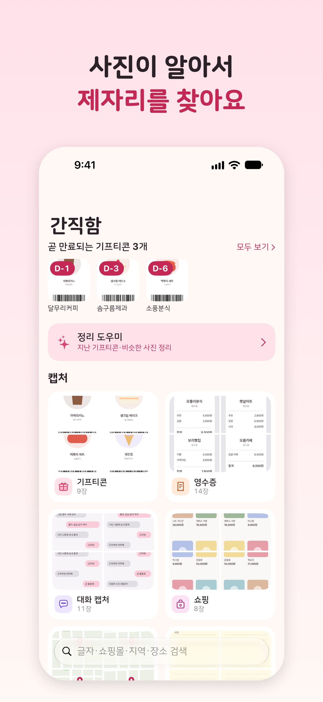
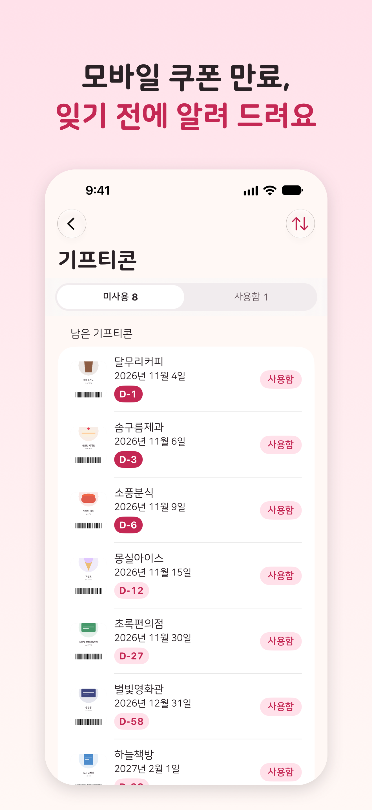
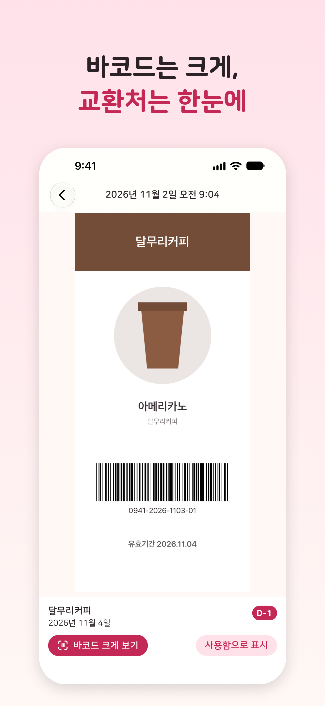
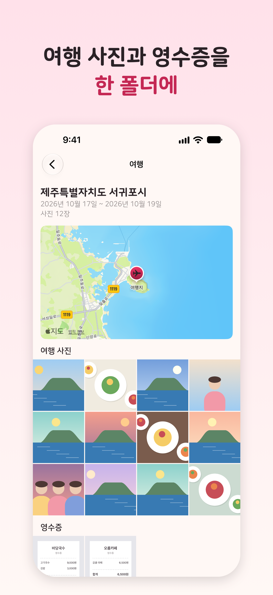
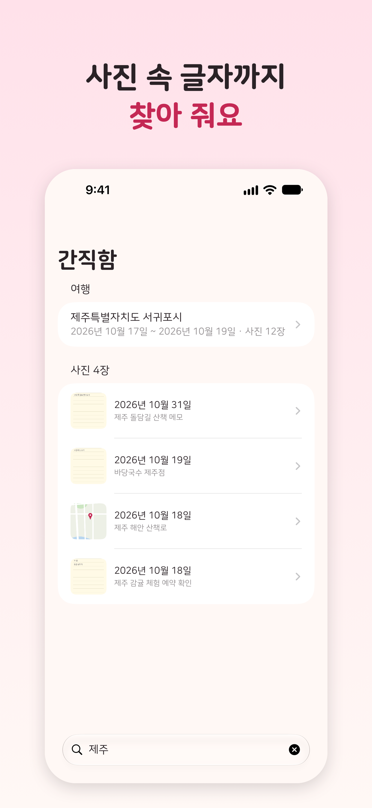
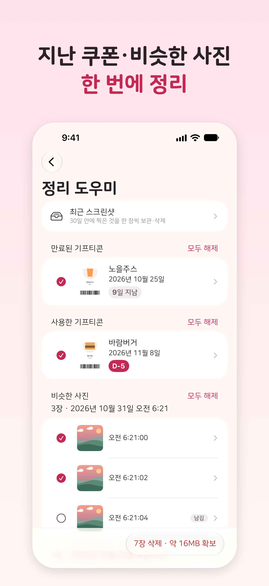
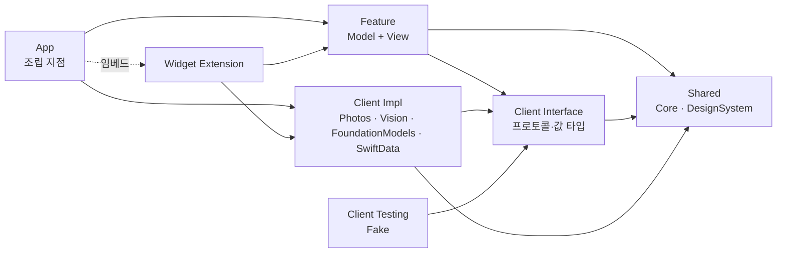

# 간직함 — 사진 자동 정리

사진 보관함의 이미지를 **기기 안에서** 자동으로 나누고, 모바일 쿠폰 만료일을 찾아 미리 알려 주는 iOS 앱입니다.
저장해 둔 쿠폰·영수증·캡처가 카메라 사진 사이에 묻혀 못 찾거나 기한을 놓치는 일을 줄이려고 만들었습니다.

**사진은 기기 밖으로 나가지 않고, 사진에서 읽은 글자도 직접 눌러 지도 앱으로 넘기는 주소 말고는 나가지 않습니다.** 서버·계정·광고·분석 도구가 없습니다. 앱이 밖으로 보내는 것은 아래뿐입니다.
- 장소 이름 변환과 지도 표시: 사진에 기록된 위치를 반올림한 대략적인 좌표와 언어·지역 설정만 Apple 시스템 서비스(MapKit)로 보냅니다. 사용자가 지도를 움직이면 그 영역의 지도도 요청합니다.
- 사용자가 주소를 누를 때: 그 주소를 지도 앱으로 넘깁니다.
- 사용자가 처리방침 링크를 누를 때: 기본 브라우저로 웹 페이지를 엽니다. 앱이 보내는 데이터는 없습니다.

자세한 내용은 [개인정보 처리방침](https://zopandagom.github.io/snapsort-ios/privacy/)에 있습니다.

iOS 26 이상, iPhone 전용, 한국어. App Store 출시를 준비하고 있습니다.

| | | |
|:---:|:---:|:---:|
|  |  |  |
|  |  |  |

<sub>스크린샷은 Example 앱의 스토어 시나리오(코드로 그린 그림, 가상 브랜드, 지어낸 번호)로 찍었습니다. 실제 사진은 들어 있지 않습니다.</sub>

## 기능

**알아서 나누는 보관함**
- 캡처는 모바일 쿠폰·영수증·쇼핑·대화 캡처·지도·문서·메모로, 사진은 여행·음식·인물·반려동물·풍경으로 나눕니다. 한 장이 여러 카테고리에 들어갈 수 있습니다.
- 새로 찍거나 저장한 사진도 이어서 분류합니다. 처음 분류는 앱을 나가도 이어 갈 수 있고, 그 뒤에는 시스템이 허락하는 백그라운드 시간에 분류합니다.
- 사진을 일부만 허용해도 고른 사진 안에서 분류하고 정리합니다.

**모바일 쿠폰 만료 알림**
- 쿠폰 이미지에서 만료일과 교환처를 읽어 남은 날짜(D-day)순으로 보여 줍니다.
- 만료 7일 전과 1일 전에 로컬 알림을 보냅니다. "사용함"으로 표시한 쿠폰은 알림에서 빠집니다.
- 7일 안에 만료되는 쿠폰은 보관함 맨 위 띠에 모아 보여 줍니다. 홈·잠금 화면 위젯에는 그 개수와 가장 가까운 D-day 가 나옵니다.

**카테고리마다 맞는 묶음**
- 영수증은 달별·가게별로 묶어 합계 금액을 보여 줍니다.
- 쇼핑 캡처는 쇼핑몰·브랜드별로, 대화 캡처는 앱별로, 지도 캡처는 지역별로 묶습니다.
- 여행은 위치와 날짜로 찾아 폴더로 묶고, 그 기간의 영수증·지도·문서 캡처도 함께 보여 줍니다.

**캡처에서 바로 행동**
- 쿠폰 바코드를 화면 밝기를 올려 크게 보여 줍니다.
- 캡처에서 읽은 주소는 눌러서 지도 앱으로 엽니다.
- 송장·계좌번호는 이 기기에서만 붙여 넣을 수 있게 복사합니다(다른 기기로 넘어가지 않습니다).

**검색**
- 사진에서 읽은 글자에 더해 쇼핑몰·브랜드·대화 앱·지역 이름으로 찾습니다.
- 카테고리와 여행 장소로 바로 이동하고, 결과의 사진을 열면 주소 열기·번호 복사를 바로 할 수 있습니다.

**정리 도우미**
- 만료됐거나 사용한 쿠폰, 비슷하게 여러 장 찍은 사진, 최근 스크린샷을 모아 한 번에 정리합니다.
- 정리하면 공간이 얼마나 생길지 미리 보여 줍니다.
- 사진은 시스템 확인 창에서 허락했을 때만 지워지고, 사진 앱의 '최근 삭제된 항목'에 30일 동안 남습니다.

## iOS 사진 앱과 비교

iOS 사진 앱도 사진을 자동으로 모아 줍니다. 아래는 [iPhone 사용 설명서](https://support.apple.com/ko-kr/guide/iphone/welcome/ios)(iOS 27판)와 Apple 지원 문서(각주, 모두 2026-11-03 확인)에 적힌 사진 앱 기능과 간직함을 나란히 놓은 것입니다. "설명서에 없음"은 이 문서들에서 그 기능을 찾지 못했다는 뜻입니다. 사진 앱이 그 일을 전혀 못 한다는 뜻은 아닙니다.

| 하고 싶은 일 | iOS 사진 앱 | 간직함 |
|---|---|---|
| 모바일 쿠폰 기한 챙기기 | 쿠폰 모음·만료일 읽기는 설명서에 없음. '기타'에 QR 코드 모음이 있음[^utilities] | 만료일·교환처를 읽어 D-day순으로 정렬, 7일·1일 전 알림, 사용함 표시, 위젯 |
| 영수증 모아 보기 | '기타'의 영수증 모음[^utilities] | 달별·가게별 묶음과 합계 금액 |
| 캡처 종류별로 보기 | 기본 '고정된 모음'의 스크린샷 모음[^pinned]. '기타'에 신분증·손글씨·일러스트 모음[^utilities] | 쇼핑(쇼핑몰·브랜드별)·대화(앱별)·지도(지역별)·문서로 나눠 묶음 |
| 여행 돌아보기 | 사진의 위치 데이터로 묶은 '여행' 모음, 연도별 찾기[^trips] | 위치·날짜로 묶은 여행 폴더에 그 기간의 영수증·지도·문서 캡처도 함께 보여 줌 |
| 보관함 정리 | '중복된 항목'을 찾아 병합[^duplicates] | 비슷하게 여러 장 찍은 사진, 만료·사용한 쿠폰, 최근 스크린샷을 모아 확보 용량을 보여 준 뒤 정리 |
| 글자로 찾기 | 사진 속 텍스트(이메일 주소·전화번호 등)로 검색. 날짜·장소·업체 이름·인물·반려동물·캡션 검색. Apple Intelligence 기기에서는 자연어 검색[^search] | 읽은 글자에 더해 분류에서 나온 쇼핑몰·브랜드·대화 앱·지역 이름으로 검색, 결과 사진에서 바로 주소 열기·번호 복사 |
| 캡처 속 정보 쓰기 | 라이브 텍스트로 글자 복사·번역, 탭해서 전화·이메일·경로 찾기[^livetext] | 바코드를 밝기 최대로 크게 보기, 주소를 지도 앱으로 열기, 송장·계좌번호를 이 기기에서만 붙여 넣게 복사 |

**사진 앱이 더 나은 점**도 분명합니다. 인물·반려동물에 이름을 붙여 찾기, Apple Intelligence 자연어 검색, 동영상, 편집, iCloud 사진 동기화는 간직함에 없습니다. 간직함은 사진 앱을 대신하는 앱이 아닙니다. 사진 앱 보관함을 읽어 **캡처와 쿠폰을 쓰기 좋게** 나눠 보여 주는 도우미입니다. 사진을 옮기거나 복사하지 않으며, 지우는 것도 사진 앱 보관함에서 지워집니다.

[^utilities]: [iPhone에서 최근에 편집된 사진, 영수증, QR 코드 등 찾기](https://support.apple.com/ko-kr/guide/iphone/iph995007f21/ios). 영어판의 Utilities 가 한국어판에서는 '기타'입니다.
[^pinned]: [iPhone 또는 iPad의 사진 앱에서 즐겨찾기에 저장한 사진 및 앨범 찾기](https://support.apple.com/ko-kr/121870)
[^trips]: [iPhone에서 여행 사진 및 비디오 찾기](https://support.apple.com/ko-kr/guide/iphone/iph7cce5d7a2/ios)
[^duplicates]: [iPhone에서 중복된 사진과 비디오 병합하기](https://support.apple.com/ko-kr/guide/iphone/iph1978d9c23/ios)
[^search]: [iPhone에서 사진 및 비디오 검색하기](https://support.apple.com/ko-kr/guide/iphone/iph392d77d5f/ios)
[^livetext]: [iPhone 또는 iPad에서 사진 속 텍스트 복사 및 번역하기](https://support.apple.com/ko-kr/120004)

## 기술 하이라이트

- **온디바이스 분류 파이프라인.** 메타데이터(픽셀을 읽지 않음) → Vision 이미지 분류 → 글자가 있을 만한 이미지에만 OCR 과 키워드 규칙. 바코드 인식, 비슷한 사진 찾기(이미지 특징값)도 Vision 으로 기기 안에서 합니다. 규칙은 Core 모듈의 순수 함수라 단위 테스트로 고정합니다. ([ARCHITECTURE §4](docs/ARCHITECTURE.md#4-확정된-기술-결정))
- **Foundation Models 보강(검증 뒤에만 반영).** Apple Intelligence 기기에서는 온디바이스 언어 모델(`SystemLanguageModel`)이 OCR 줄을 해석해, 규칙이 '기타'로 둔 이미지의 카테고리를 제안하고 쿠폰 만료일·교환처의 빈칸을 채웁니다. 모델의 답은 확인 전 값이라 원문과 대조해 근거가 있는 것만 씁니다. 서버로 프롬프트를 보내는 Private Cloud Compute 모델은 lint 로 막습니다.
- **백그라운드 분류.** 처음 분류는 `BGContinuedProcessingTask` 로 앱을 나가도 진행 표시와 함께 이어 가고, 새 사진은 `BGProcessingTask` 로 분류합니다. 두 작업의 겹침과 앱 상태 변화는 BackgroundIndexing Client 한곳에서 맞추고 대역(fake)으로 테스트합니다.
- **규칙 기반 단방향 MV.** SwiftUI `@Observable` 모델을 View 에 직접 연결하되, 상태는 `private(set)`, View 는 이벤트 메서드만 부릅니다. 프레임워크 없이 규칙과 lint 로 지킵니다. ([ARCHITECTURE §1](docs/ARCHITECTURE.md#1-실행-흐름))
- **Tuist 모듈러 아키텍처.** 외부 시스템은 Client 모듈(Interface / Impl / Testing)로 감싸고, Feature 는 Interface 에만 의존합니다. Photos·Vision·FoundationModels·SwiftData 같은 프레임워크 import 위치, 네트워크 코드 금지 같은 경계는 SwiftLint 사용자 규칙 11개로 검사합니다. Feature 마다 Fake 로 도는 Example 앱이 있습니다.
- **Swift 6 strict concurrency.** 모든 모듈이 Swift 6 언어 모드, `SWIFT_STRICT_CONCURRENCY=complete` 입니다. Model 은 `@MainActor`, Client 가 주고받는 값은 `Sendable` 입니다.
- **CI/CD.** 코드가 바뀐 PR 마다 GitHub Actions 가 lint·빌드·테스트를 돌리고, 초안이 아닌 PR(dependabot 제외)은 Claude 가 규칙 문서 기준으로 리뷰합니다. `vX.Y.Z` 태그를 push 하면 fastlane 이 서명·업로드·심사 제출까지 합니다. 스토어 스크린샷도 스크립트로 찍고 캡션을 합성합니다.
- **Claude Code 하네스.** 검증(`/verify`)·규칙 리뷰(`/arch-review`)·역할별 커밋(`/micro-commit`)·PR(`/pr`) 스킬, 고친 파일을 언급하는 문서를 알려 주는 훅, main 직접 커밋을 막는 git 훅으로 작업 흐름을 고정했습니다. 새 상태나 실패 경로가 생기는 구현은 설계자·비판자·구현자 역할의 팀으로 진행합니다. ([CLAUDE.md](CLAUDE.md), [CONVENTIONS §6](docs/CONVENTIONS.md#6-claude-code-작업-방식))



<sub>Testing(Fake)은 테스트와 Example 앱만 씁니다. Feature 끼리는 의존하지 않습니다.</sub>

## 직접 빌드하기

```bash
make bootstrap   # 최초 1회: mise 도구·fastlane 설치, git 훅 연결
make generate    # Tuist 로 워크스페이스 생성 후 Xcode 로 열기
make test        # 전체 모듈 빌드 + 테스트 (iPhone 17 시뮬레이터)
```

Vision 이미지 분류는 시뮬레이터에서 동작하지 않아 실제 분류는 기기에서 확인합니다. 화면은 Feature 마다 있는 Example 앱(Fake 데이터)으로 시뮬레이터에서 볼 수 있습니다. 그 밖의 명령은 [CLAUDE.md 명령 표](CLAUDE.md#명령), 태그 출시는 [CONVENTIONS §5 태그 출시](docs/CONVENTIONS.md#5-git--pr)에 있습니다.

## 문서
- [아키텍처](docs/ARCHITECTURE.md): 단방향 MV, 모듈 구조, 확정된 기술 결정
- [개발 규칙](docs/CONVENTIONS.md): 해야 할 것 / 하지 말아야 할 것 (코드·테스트·git·개인정보)
- [개발 계획](docs/DEVELOPMENT_PLAN.md): 로드맵과 완료 기준
- [Claude Code 작업 안내](CLAUDE.md)
