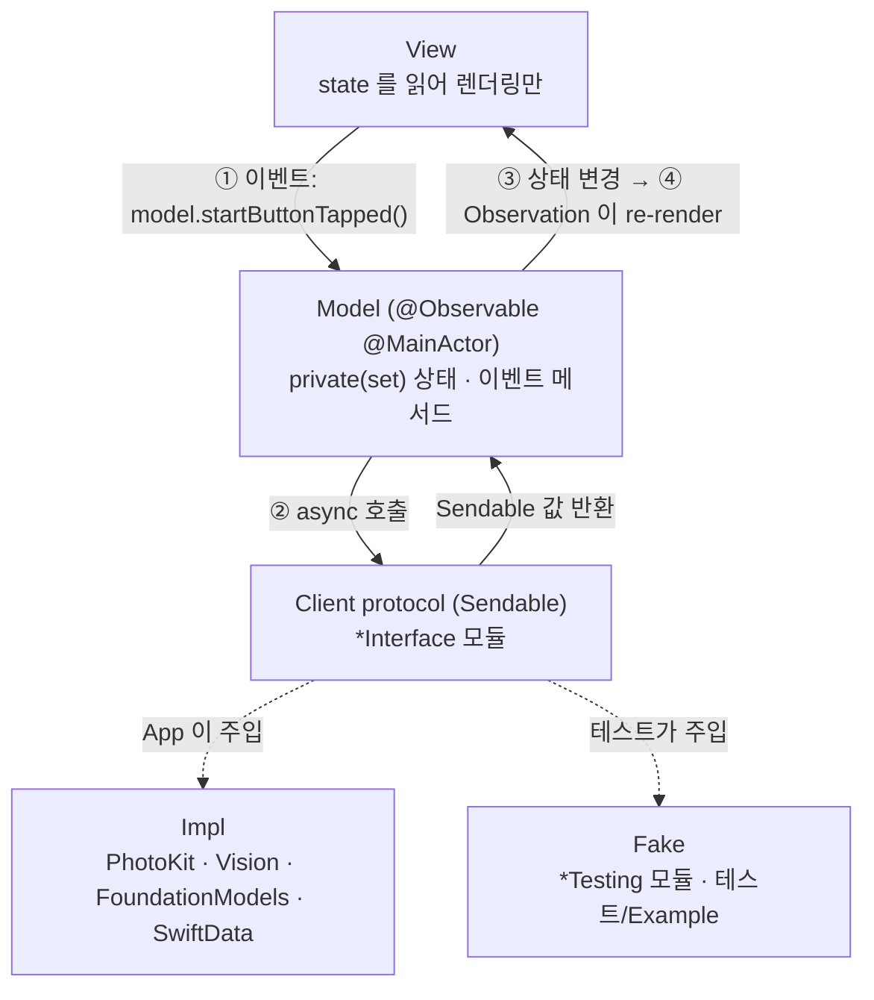
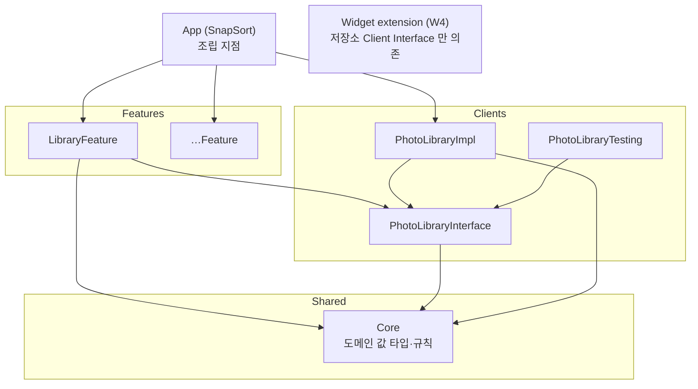

# 아키텍처

두 가지 결정 위에 서 있다.

1. **규칙 기반 단방향 MV.** SwiftUI 의 `@Observable` 모델을 View 에 직접 연결한다(Apple 샘플과 같은 방식). 단방향 흐름은 프레임워크가 아니라 규칙과 lint 로 강제한다.
2. **모듈러 아키텍처.** 외부 시스템은 Client 모듈로 감싸고, 각 Client 를 Interface / Impl / Testing 으로 나눈다. Feature 는 Interface 에만 의존한다.

## 1. 실행 흐름



### 단방향 규칙
| # | 규칙 | lint 로 강제 |
|---|---|---|
| 1 | Model 의 상태 프로퍼티는 모두 `public private(set) var` | 리뷰 |
| 2 | View 는 Model 의 **이벤트 메서드**만 호출한다. 이름은 "무슨 일이 일어났는가"로 짓는다: `onAppear()`, `startButtonTapped()`, `queryChanged(_:)` | 리뷰 |
| 3 | 입력 컨트롤은 `Binding(get: { model.query }, set: { model.queryChanged($0) })` 으로 연결한다. `$model.query` 금지 | `no_two_way_model_binding` |
| 4 | 부수효과(권한, OCR, 저장, 알림)는 Model 메서드 안에서 Client 를 통해서만 실행한다. View 에서 `Task { PHPhotoLibrary… }` 금지 | `system_framework_only_in_impl` |
| 5 | Model 은 `@MainActor`, Client 가 주고받는 값은 `Sendable`. `PHAsset` 같은 비 Sendable 객체는 식별자나 Core 의 `Sendable` 값 타입(예: `ImageAsset`)으로 바꿔서 넘긴다 | 컴파일러 (Swift 6 strict) |
| 6 | Model 끼리 직접 참조하지 않는다. 화면 간 흐름은 App 이 조립하거나 공유 Client 를 거친다 | 모듈 경계 |
| 7 | Model 은 App(또는 Example 앱)이 `@State` 로 **소유**하고, View 는 `let model: XxxModel` 로 **참조**만 한다. View 안에서 Model 을 생성하거나 `@State` 로 다시 감싸지 않는다 | 리뷰 |
| 8 | View 전용 일시 상태(애니메이션, 포커스, 시트 표시 여부)는 View 의 `@State private var` 로 둬도 된다. 화면에만 걸린 시스템 UI 설정(예: 기록 중 자동 잠금 끄기 `isIdleTimerDisabled`)도 View 가 맡는다. 저장·외부로 남지 않고 화면을 떠나면 되돌리므로 규칙 4 의 부수효과가 아니다. 비즈니스 의미가 있으면 Model 로 옮긴다 | 리뷰 |

### 예시 (OnboardingFeature)
```swift
@MainActor
@Observable
public final class OnboardingModel {
  public private(set) var access: PhotoAccessState

  @ObservationIgnored private let photoLibrary: any PhotoLibraryClient

  public func startButtonTapped() async {
    self.access = await self.photoLibrary.requestAccess()
  }
}

// View
Button("정리 시작하기") { Task { await self.model.startButtonTapped() } }

// App: 화면 간 흐름은 App 이 정한다 (규칙 6)
if self.onboardingModel.access.canRead {
  LibraryView(model: self.libraryModel)
} else {
  OnboardingView(model: self.onboardingModel)
}
```

## 2. 모듈 구조



### 모듈 종류와 타깃
| 종류 | 위치 | 타깃 | 역할 |
|---|---|---|---|
| App | `Projects/App` | `SnapSort` | 유일한 조립 지점. Impl 을 생성해 Model 에 주입 |
| Feature | `Projects/Features/<Name>` | `<Name>Feature` · `<Name>FeatureTests` · `<Name>FeatureExample` | 화면 하나 또는 흐름 하나. Model + View |
| Client | `Projects/Clients/<Name>` | `<Name>Interface` · `<Name>Impl` · `<Name>Testing` · `<Name>Tests` | 외부 시스템 경계 |
| Shared | `Projects/Shared/<Name>` | `<Name>` · `<Name>Tests` | 여러 모듈이 함께 쓰는 코드. `Core`(도메인 값 타입·규칙), `DesignSystem`(W4, 공용 UI) |

- **Interface**: 프로토콜과 값 타입(`PhotoAccessState` 등)만. Apple 데이터 프레임워크와 CoreLocation·MapKit 을 import 하지 않는다.
- **Impl**: 프로토콜 구현. 구현 타입 이름은 `<Name>ClientImpl`. Apple 데이터 프레임워크(Photos·Vision·FoundationModels·SwiftData·StoreKit·UserNotifications) import 는 여기서만. 예외: Feature View 의 MapKit `Map` 렌더링(§4). 이 목록과 CoreLocation·MapKit(§4 경계) 밖의 iOS 프레임워크(CoreGraphics·ImageIO 등)는 Core 를 포함한 모든 레이어에서 쓸 수 있다. 제한은 권한·저장·외부 서비스 같은 부수효과를 Impl 에 가두기 위한 것이므로, 부수효과 없는 프레임워크를 피하려고 실행 비용을 들이지 않는다.
- **Testing**: `<Name>ClientFake`. 고정 값을 돌려주는 `struct` 로 시작하고, 호출 기록이 필요하거나 호출 사이에 상태가 남아야 하면(저장 결과, 바뀐 권한) 그때 상태를 `Mutex` 로 보호하는 `final class` 로 확장한다.
- **Example**: Fake 로 Feature 를 단독 실행하는 데모 앱. **`#Preview` 도 여기에 둔다** (Feature 모듈이 Testing 에 의존하지 않도록).
- **Debug 전용 Feature**(SampleRecorder): Sources 의 모든 파일을 `#if DEBUG` 로 감싸고 App 도 `#if DEBUG` 에서만 연결해 Release 에 들어가지 않는다(Tuist 의존성은 구성별로 나눌 수 없어 Release 에서는 빈 모듈을 링크한다). 확인은 `SnapSort` 스킴을 Release 구성으로 빌드해 앱 바이너리에 `SampleRecorder` 심볼이 없는지 본다(`make project` 뒤 `xcodebuild build -workspace SnapSort.xcworkspace -scheme SnapSort -configuration Release -destination 'generic/platform=iOS Simulator' -derivedDataPath build/ReleaseDD CODE_SIGNING_ALLOWED=NO -quiet && nm build/ReleaseDD/Build/Products/Release-iphonesimulator/SnapSort.app/SnapSort > build/release-symbols.txt && ! grep -q SampleRecorder build/release-symbols.txt && echo "기록 도구 없음"` 이 "기록 도구 없음"을 출력하면 통과. 빌드·`nm` 중 하나라도 실패하면 출력이 없도록 `&&` 로 잇고 개수가 아니라 이 문구로 판정한다). 기록 도구 Sources(`Projects/Features/SampleRecorder/Sources`)나 App(`Projects/App`)을 바꾼 작업에서 Claude 가 수용 확인(CONVENTIONS §6)으로 실행한다. Example 앱은 Debug 로만 빌드하므로 모든 타깃을 담은 `SnapSort-Workspace` 스킴은 Release 로 빌드되지 않는다.
- **Shared**: Apple 데이터 프레임워크, CoreLocation·MapKit, Client 모듈을 import 하지 않는다. Core 는 부수효과 없는 순수 코드이고(SwiftUI·UIKit 도 쓰지 않는다. lint `core_no_ui_framework`), 좌표·분석 이미지처럼 여러 Client 의 Interface 가 함께 쓰는 값 타입을 둔다. DesignSystem 은 SwiftUI 까지 쓴다.

### 의존 규칙
| from ↓ / to → | Feature | Interface | Impl | Testing | Shared |
|---|---|---|---|---|---|
| App | ✅ | ✅ | ✅ | ❌ | ✅ |
| Feature | ❌ | ✅ | ❌ | ❌ | ✅ |
| Feature Tests / Example | 자기 Feature | ✅ | ❌ | ✅ | ✅ |
| Client Interface | ❌ | ❌ | ❌ | ❌ | ✅ |
| Client Impl | ❌ | 자기 Interface (+ 다른 Interface) | ❌ | ❌ | ✅ |
| Client Tests | ❌ | ✅ | 자기 Impl | 자기 Testing (+ Impl 이 쓰는 다른 Client 의 Testing) | ✅ |
| Shared | ❌ | ❌ | ❌ | ❌ | ❌ (필요해지면 템플릿에 인자를 추가하고 연다) |

### 빌드 설정
- 모든 모듈은 static framework. iPhone 전용, iOS 26.0+, Swift 6 언어 모드, `SWIFT_STRICT_CONCURRENCY=complete`.
- 설정은 `Tuist/ProjectDescriptionHelpers/Project+Templates.swift` 의 `Env` 에서만 바꾼다. 개별 매니페스트에서 덮어쓰지 않는다.
- 서명: 모든 타깃이 Xcode 자동 서명(`CODE_SIGN_STYLE=Automatic`)과 `Env.developmentTeam` 팀을 쓴다. 실기기 빌드는 Xcode 가 인증서·프로파일을 관리하고, `make build`/`make test` 와 CI 는 `CODE_SIGNING_ALLOWED=NO` 로 서명 없이 빌드한다.
- 타깃 소스·리소스는 Xcode 동기화 폴더(`buildableFolders`)로 연결한다. 기존 폴더 안에서 파일을 추가·삭제하면 다시 생성하지 않아도 Xcode 와 빌드에 반영된다. 모듈·타깃·의존성을 바꿀 때만 `make project` 를 다시 돌린다.

## 3. 모듈 추가 방법

### Client 추가 (예: ImageAnalysis)
1. `Tuist/ProjectDescriptionHelpers/Module.swift` 의 `Client` 에 `case imageAnalysis = "ImageAnalysis"` 추가.
2. 디렉터리 생성: `Projects/Clients/ImageAnalysis/{Interface,Impl,Testing,Tests}` + `Project.swift`:
   ```swift
   import ProjectDescription
   import ProjectDescriptionHelpers

   let project = Project.client(.imageAnalysis, shared: [.core])
   ```
   Impl 이 다른 Client 를 조합하면(예: Indexing) `clients: [.photoLibrary, …]` 를 더한다. Impl 에는 그 Interface 가, Tests 에는 Interface 와 Testing(Fake)이 연결된다.
3. Interface 에 `public protocol ImageAnalysisClient: Sendable` 과 입출력 값 타입, Impl 에 `ImageAnalysisClientImpl`, Testing 에 `ImageAnalysisClientFake`, Tests 에 Impl 의 순수 로직 테스트.
4. 사용하는 Feature 매니페스트의 `clients:` 에 추가하고, App 매니페스트에 `.client(impl: .imageAnalysis)` 추가.
5. `make project && make test`.

### Shared 추가 (예: Core)
1. `Module.swift` 의 `Shared` 에 `case core = "Core"` 추가.
2. `Projects/Shared/Core/{Sources,Tests}` + `Project.swift`:
   ```swift
   let project = Project.shared(.core)
   ```
3. 쓰는 모듈의 매니페스트에 연결한다: Feature 는 `Project.feature(_, clients:, shared: [.core])`, Client 는 `Project.client(_, shared: [.core])`, App 은 `dependencies` 에 `.shared(.core)`.
   DesignSystem 같은 공용 UI 모듈은 Feature 와 App 에서만 쓴다 (Interface 는 프로토콜과 값 타입만).

### Feature 추가 (예: Onboarding)
1. `Feature` 에 `case onboarding = "Onboarding"` 추가.
2. `Projects/Features/Onboarding/{Sources,Tests,Example}` + `Project.swift`:
   ```swift
   let project = Project.feature(.onboarding, clients: [.photoLibrary])
   ```
3. `Sources` 에 `OnboardingModel`, `OnboardingView`. `Tests` 에 Model 테스트. `Example` 에 `@main` 데모 앱과 `#Preview`.
4. App 매니페스트 dependencies 에 `.feature(.onboarding)` 추가, `SnapSortApp` 에서 Model 을 만들어 연결.

## 4. 확정된 기술 결정
| 결정 | 이유 |
|---|---|
| 서버 없음 | "사진이 밖으로 나가지 않는다"가 제품 가치. StoreKit 2 는 기기에서 영수증 검증 |
| 위치·지도는 Apple 시스템 서비스 | 장소 이름 변환은 MapKit `MKReverseGeocodingRequest`(`CLGeocoder` 는 iOS 26 에서 deprecated. 요청 수 제한이 있으므로 사진마다가 아니라 위치 묶음마다), 지도 핀은 MapKit `Map`. 모듈 경계: ① Feature View 는 `Map` 렌더링만을 위해 MapKit 을 import 할 수 있다 ② 지오코딩과 지도 앱 열기는 부수효과이므로 Client Impl 에서 한다 ③ Interface 의 좌표는 자체 `Sendable` 값 타입으로 둔다(`CLLocationCoordinate2D` 노출 금지). Shared·Interface·Testing 의 CoreLocation·MapKit import 는 lint(`location_map_only_outside_shared_interface`)가 막고, Feature 의 `Map` 렌더링 외 사용은 리뷰로 잡는다. 이때 **위치 좌표만** Apple 로 가고 사진과 OCR 텍스트는 보내지 않는다. OCR 로 읽은 주소를 지도 앱으로 넘기는 것은 사용자가 누를 때만. 개인정보 처리방침에 명시한다. 지오코딩 요청 원칙: ① 사용자가 장소가 필요한 화면(여행 폴더)을 열 때만 요청하고 결과는 기기에 캐시한다. 여행은 판정할 때마다 다시 만들어지므로 캐시 키는 여행이 아니라 ③의 반올림한 중심점이다. 백그라운드 일괄 지오코딩 금지 ② 사진 좌표는 여행 판정이 찾은 여행(Core `Trip`)의 중심점만 지오코딩하고, 여행이 아닌 사진 좌표 묶음은 지오코딩하지 않는다. 여행은 자주 가는 지역 밖에서만 나오므로 집 근처 좌표는 보내지 않는다 ③ 보내는 좌표는 묶음 중심점을 소수점 2자리(약 1km)로 반올림한 값. 구체적인 수치는 구현 PR 에서 조정할 수 있다 |
| 분류 대상 | 보관함의 모든 이미지(영상 제외). 스크린샷 여부(`.photoScreenshot`)는 조회 필터가 아니라 분류 신호로 쓴다 |
| 분류 3단 파이프라인 | ① 메타데이터(스크린샷 여부·위치·날짜·크기, 픽셀을 읽지 않음) → ② Vision 이미지 분류(`ClassifyImageRequest`) 라벨(ImageAnalysis Client, Core `ImageLabel`. 신뢰도 기준(Core `ClassificationRules.minimumLabelConfidence`, 임시 0.1)은 정확도 측정 작업에서 확정. 시뮬레이터에서는 동작하지 않아 실기기로 확인한다) → ③ 스크린샷(메타데이터 또는 `screenshot` 라벨), 정보형·글자가 많은 라벨(`document`·`receipt`·`coupon`·`ticket` 등, 신뢰도 0.3(`ClassificationRules.textLabelMinimumConfidence`) 이상. 식탁 위 메뉴판·만화·그림에 약하게 붙는 문서 라벨을 거른다)이 있는 이미지(위치·사진형 카테고리는 보지 않는다. 실기기 보관함 1만 장에서 위치도 사진형 카테고리도 없어서 OCR 한 이미지는 모두 기타였고, 저장한 기프티콘은 글자 라벨로 잡혔다. 위치 없이 음식 라벨만 붙은 저장 기프티콘도 없었다)만 OCR(대상 판정은 Core `TextRecognitionPolicy`. `RecognizeTextRequest`. ImageAnalysis Client, Core `RecognizedTextLine` = 줄 텍스트·신뢰도·왼쪽 위 원점 정규화 위치. 한국어 우선 + 영어, 정확도 우선 + 언어 보정. 빈 줄만 버리고 신뢰도 기준은 정확도 측정 작업에서 정한다)+ 키워드 규칙(Core `RuleClassifier` 순수 함수: 정보형은 라벨 하나 또는 OCR 키워드 기준 개수 이상(문서는 라벨에 더해 OCR 글자 30자 이상), 대화 캡처는 단독 줄의 오전·오후 말풍선 시각이 2개 이상이고 대체로 오름차순일 때도(최신순인 통화 기록·알림 센터, 영문 AM·PM 탑승권은 제외), 사진형은 스크린샷(메타데이터 또는 `screenshot` 라벨)이 아닐 때 라벨로 정한다(인물 0.3·풍경 0.4 이상, 그림 라벨(0.5 이상)이 있으면 붙이지 않고, 인물이 있으면 풍경은 붙이지 않는다). 여행은 여행 판정이 정한다). 라벨·키워드 표(Core `ClassificationRules`)와 OCR 대상 조건은 정확도 측정 작업에서 픽스처(Core 테스트의 `ClassificationSamples.json` 에 실기기에서 기록한(기록 도구, 이 표의 "기록 도구 (Debug 전용)" 행. 라벨은 0.01 까지 기록) 분류 입력과 기대 카테고리를 둔다, CONVENTIONS §3. 시드 샘플: `ClassificationAccuracyTests` 머리 주석)로 조정한다. 인덱서는 모든 새 이미지의 ①②를 먼저 저장하고(1단계) ③은 OCR 대상만 나중에(2단계) 한다(이 표의 "인덱싱" 행). ①~③은 모든 기기에서 동작한다. `SystemLanguageModel.default.availability == .available` 인 기기에서는 ③ 뒤에 Foundation Models 로 OCR 텍스트를 해석해 보강한다: 글자를 읽었는데 규칙 분류가 기타뿐인 이미지에 원문 근거가 있는 정보형만 더하고(Core `ModelCategoryPolicy`), 기프티콘 추출에서 규칙이 비운 필드만 채운다(Core `GifticonExtractor.filling`). 모델 답은 Classifier Client 가 돌려주는 확인 전 값이고, 받는 쪽이 Core 로 원문과 대조한 것만 쓴다(이 표의 "Foundation Models 보강" 행). Vision 은 Swift 네이티브 API(`VN` 접두사 없는 async 요청)만 쓴다 |
| 분석 이미지 크기 | 이미지 분류·유사 이미지는 썸네일(`ImageSize.thumbnail`)로, OCR·바코드는 기기에 있는 가장 큰 버전(`.largestAvailable`)으로 분석한다. PhotoLibrary 가 Core 의 `AnalysisImage`(디코딩된 `CGImage` + 방향 + 대체 버전 여부 `isLocalFallback`)로 읽어 주고, 분석 Client 는 이것만 받는다(Photos import 는 PhotoLibrary Impl 한 곳). 어느 경우든 `isNetworkAccessAllowed = false` 로 iCloud 원본을 내려받지 않는다. 원본이 iCloud 에만 있으면 기기에서 바로 줄 수 있는 버전을 쓰고(가장 큰 버전이라는 보장은 없다) 대체 버전이면 `isLocalFallback` 으로 표시하며(기록 도구가 센다), 그것도 없으면 `ImageLoadError.notAvailableLocally` 로 알려 받는 쪽이 나중에 다시 시도한다. 썸네일 긴 변(임시 512px)은 정확도·1만 장 측정 작업에서 확정한다. `.largestAvailable` 픽셀 수 상한은 약 12.6MP(4096×3072)로 확정했다: Debug 기록 도구의 OCR 해상도 비교(이 표의 "기록 도구 (Debug 전용)" 행)에서 8·4·2·1MP 로 줄여도 OCR 시간은 줄지 않고(시간은 픽셀 수가 아니라 읽은 줄 수에 비례한다) 글자·날짜·긴 숫자열만 놓쳤다(iPhone 14 Pro, 최신 1,000장 중 OCR 대상 272장). 상한은 OCR·바코드 공용이지만 바코드는 이 비교로 재지 않았고, 시뮬레이터에서 바코드 인식이 돌지 않아("캡처 정보 추출" 행) 아직 확인하지 못했다. 바코드 크게 보기 화면 작업(W4)에서 실기기로 확인한다. 원본은 디코딩하면서 상한으로 줄여(`CGImageSourceCreateThumbnailAtIndex`) 48MP 한 장에 약 190MB 대신 약 50MB 만 쓴다. 상한을 긴 변이 아니라 픽셀 수로 두어 스크롤 캡처·긴 영수증처럼 세로로 긴 이미지도 폭이 지나치게 줄지 않는다 |
| 카테고리 | 정보형(기프티콘·영수증·대화 캡처·쇼핑·지도·문서/메모), 사진형(여행·음식·인물·반려동물·풍경), 기타. 한 이미지가 여러 카테고리에 속할 수 있다 |
| 여행 판정 | 이미지 라벨이 아니라 위치·날짜로 판단한다(Core `TravelDetector` 순수 함수, 결과는 Core `Trip` = 사진 식별자·기간·중심점. 중심점은 사진이 가장 많은 칸 안의 사진 평균이라 자주 가는 지역이나 여행지 사이에 떨어지지 않는다). 여행은 "평소와 다른 곳"이라서 먼저 자주 가는 지역을 정한다: 지역 칸(위도·경도 0.18도. 위도 방향 약 20km, 서울에서 경도 방향 약 16km)마다 방문(그 칸과 맞닿은 칸에서 빈 날 하루까지 이어 사진을 찍은 기간 중 그 칸에 들른 날들. 맞닿은 칸을 오가도 한 번)을 묶고, 사진이 속한 방문의 앞뒤 3개월 안에 방문이 3번 이상이거나 첫날과 마지막 날이 60일 이상 떨어진 방문이 있는 곳, 보관함 전체에서 찍은 날이 가장 많은 곳(보관함이 짧거나 집 사진이 드물 때를 위해), 그리고 그 칸에 맞닿은 칸. 사진 수나 날 수로 세면 여행에서 많이 찍거나 오래 머문 곳이, 달로 세면 달 경계에 걸친 여행 하나가 두 번으로 세어지므로 방문으로 센다. 보관함 전체가 아니라 그 방문 무렵을 보므로 몇 년 또는 몇 달에 걸쳐 같은 곳에 간 여행도 각각 여행이고(3개월 간격 이하로 세 번 이상 가면 가운데 방문은 자주 가는 곳으로 본다), 달 경계에 걸친 체류도 60일 미만이면 여행이다. 60일 이상 머문 곳은 생활한 곳으로 본다. 방문 단위로 판정하므로 여행이 중간에 잘리지 않는다. 이사한 곳·본가처럼 자주 가는 곳이 여럿이어도 규칙 하나로 처리한다. 자주 가는 지역 밖에서 찍은 사진을 빈 날 하루까지 이어 묶고, 중간에 자주 가는 지역에서 찍은 사진이 있으면(같은 날이어도) 끊는다. 5장 미만인 묶음은 버린다(당일치기는 포함). 위치나 날짜가 없는 이미지는 쓰지 않는다. 자주 가는 지역은 판정 안에서만 쓰고 저장하거나 보여 주지 않는다. 수치는 임시이며 정확도 측정 작업에서 조정한다. 제한 접근(`.limited`)이면 사용자가 고른 사진만으로 판정하고, 정확도가 낮을 수 있다고 화면에 안내한다 |
| 기프티콘 추출 | 기프티콘으로 분류한 이미지의 OCR 줄에서 만료일과 교환처를 찾는다(Core `GifticonExtractor` 순수 함수, 결과는 Core `GifticonInfo`). 줄 맨 앞의 라벨("유효기간"·"사용기한"·"교환처" 등, 앞쪽 기호와 공백은 무시. 안내문 속 라벨 단어와 조사를 붙여 띄어 쓴 라벨("유효기간이 지난")은 라벨이 아니다)이 있는 줄의 라벨 뒤, 없으면 라벨 오른쪽 같은 높이 줄(날짜가 없으면 바로 아래 줄)의 값을 읽고, 값 줄에도 라벨 줄과 같은 규칙을 쓴다. 날짜와 그 앞뒤 경계는 원문에서 판단해 날짜 뒤의 시각("2026.12.31 23:59")이 날짜를 막지 않는다. 만료일은 `2026.12.31`·`26-12-31`·`2026년 12월 31일`·`12월 31일` 형식을 읽고(두 자리 연도는 같은 구분 기호로 붙여 쓴 것과 `26년 12월 31일` 형식만), 한 줄 안에서는 첫 날짜(앞에 글자가 없어야 한다)부터 끊기지 않고 기간으로 이어진 "까지" 날짜, 없으면 첫 날짜를 쓰고, 첫 날짜가 "부터"·이어짐 기호(물결·줄표 변형)·잇는 말("to"·"until"·"through"·"thru"·"till"·"에서"·"내지") 또는 공백만으로 다음 날짜와 이어진 기간이면 끝 날짜를 쓴다. 앞 날짜보다 이른 날짜(앞 날짜의 연도를 알 때 연도 보정 뒤 비교)는 기간의 끝으로도 "까지" 기한으로도 잇지 않고, 첫 날짜 앞에 글자가 있으면 다른 항목의 날짜로 보고 쓰지 않는다(두 열을 한 줄로 읽은 주문일·발행일을 거른다). 다음 줄로 넘어간 기간의 끝 날짜는 시작 날짜보다 이를 수 없고, 줄이 이어짐 기호·"부터"·잇는 말로 끝나거나 오른쪽 같은 높이 줄이나 아래 줄이 이어짐 표시(이어짐 기호, 또는 영문 잇는 말. 공백 없이 붙은 "to2026.12.31" 도 표시다)와 날짜로 시작하면(표시 뒤가 날짜 모양이어야 한다. 날짜 표기의 앞부분("2027.10"·"27.10"·"10월")이나 영문 날짜 앞부분(월 이름 뒤 점 하나를 건너뛴 숫자 "Dec 31"·"Dec. 31", 일-월 순 "31 Dec", 서수 "31st", 연-월 이름 "2026 Dec")이고, 할인 금액 "-3,000" 처럼 숫자로만 시작하는 것과 월 이름으로 시작하는 영문 단어 "~ maybe" 는 아니다. 표시가 기간에만 쓰이는 물결표 계열이나 영문 잇는 말("to 2026.12.31")이면 이어진 기간이고, 끝 날짜 뒤 줄 끝까지는 기간 끝 말("까지"·"사용 가능"·"교환 가능"·"만 유효" 등)과 맨 끝의 존댓말·종결 어미("합니다"·"입니다" 등)만 올 수 있다("~ 2027.01.31 자정"·"~ 2027.01.31까지 사용 가능합니다"). 끝 날짜 뒤에 다른 날짜나 다른 항목 안내가 있으면 끝을 믿을 수 없어 만료일을 비운다("~ 2027.01.31까지 연장 신청 가능"). 글머리표로도 쓰이는 줄표(- – —)면 날짜 표기뿐이어야 한다(기간 끝 말과 맨 끝 어미는 글로 세지 않는다. 날짜로 읽은 줄은 끝 날짜 뒤를 기간 표시와 같은 시각 판정으로 보고(숫자 없이 홀로 쓴 시각 말 "오후"·"PM" 도 막지 않는다. "- 2027.01.31 pm25" 는 시각이 아니라 글머리표다), 서수·월 이름까지 넓게 지우는 판정은 날짜로 읽지 못하는 영문 날짜 줄에만 쓴다(그 줄은 이어져도 끝을 읽지 못해 비운다). "- 2027.01.31까지 사용 가능합니다" 는 이어진 기간이고, 글이 섞인 글머리표 안내문 "- 2027.01.31까지 연장 신청 가능"·"- 1인 1매" 는 아니다. 물결표 뒤 안내문 "~ 사용 시 확인" 도 날짜 모양으로 시작하지 않아 아니다)) 끝 날짜를 그 줄에서 찾고("까지" 날짜나 기간의 끝처럼 끝이 이미 정해진 날짜는 보지 않는다. 이어진 줄에서 끝을 읽지 못하면(날짜로 읽지 못하는 영문 날짜, 기간 표시 줄에서 첫 날짜가 기간으로 이어지지 않음) 시작 날짜를 쓰지 않고 만료일을 비운다. 줄표 줄에서 첫 날짜가 이어지지 않으면 이어진 줄로 보지 않는다)(라벨 뒤에 날짜 없는 설명이 있거나 이어지는 날짜 앞에 다른 글이 있거나 줄 안의 날짜가 한 기간으로 이어지지 않으면 값 줄을 읽지 않는다), 같은 줄에서 기간의 끝을 읽지 못하면("~ 12.31"·"부터 12.31까지"·물결표가 빠진 "2026.01.01 12.31" 처럼 날짜로 읽지 못함, 이어짐 기호·"부터"·잇는 말 뒤의 영문 날짜("~ Dec 31, 2026"·"to Dec 31, 2026"), "부터" 뒤에 날짜가 아닌 글이 오는 경우("2026.10.01부터 사용 가능". 끝을 읽지 못한 것으로 보고 비운다. 줄이 "부터"로 끝나면 위처럼 다음 줄에서 끝을 찾는다), 달력에 없는 날짜) 시작 날짜를 쓰지 않으며 그 아래 줄도 값으로 읽지 않는다. 어느 경우든 시작 날짜를 만료일로 쓰지 않는다. 날짜 뒤의 요일 괄호("(목)")와 시각("23:59", AM/PM·a.m./p.m.·오전/오후가 붙은 것, 시만 있는 AM/PM(뒤에 붙은 "12AM"·"11 PM" 은 시 1~12 이고 뒤에 영문자가 오면 아니다("2 amazon"). 앞에 붙은 "PM 11" 은 시 1~12 이고 시 뒤에 숫자·점·콜론·슬래시가 오면 아니며("pm25"·"pm2.5"), 줄표는 그 뒤가 날짜일 때만 시각이다("AM 9 - 2026.12.31" 은 시각이라 "2026.01.01 AM 9 - 2026.12.31 PM 11" 은 기간, "PM 12-31" 은 아니다)), "23시 59분", "자정"·"정오"·"midnight"·"noon")은 건너뛴다("2026.01.01 12:00 AM ~ 2026.12.31 11:59 PM" 은 기간, "2026.12.31 자정까지" 는 "까지" 기한). 라벨 줄에서 만료일을 못 찾으면 날짜 뒤에 "까지"가 붙은 날짜만 만료일로 보고(발행일·주문일을 거른다), 여럿이면 가장 늦은 것을 쓴다(주문 취소 기한 등을 거른다. 연도를 모르는 기한이 연도를 아는 기한보다 늦게 계산되면 어느 쪽인지 알 수 없어 비운다). 라벨 줄이나 그 값 줄에서 기간이 시작됐으면 그보다 이른 기한과 날짜 앞에 글이 있는 기한("주문 취소는 2026.10.07까지")은 쓰지 않고(시작이 여럿이면 가장 늦은 것), 라벨 줄·값 줄에 날짜가 있는데 끝을 읽지 못했거나 라벨 뒤·값 줄에 날짜 없는 상대 기간(숫자가 든 설명, "구매일로부터 1년")만 있으면 "까지" 기한도 쓰지 않는다(숫자 없는 안내문 "유효기간 만료 후 환불 불가" 는 막지 않는다). 만료일 라벨 줄이 여럿이면 OCR 순서로 보되, 앞 라벨 줄에서 이렇게 만료일을 알 수 없게 됐거나 기간이 시작됐으면 뒤 라벨 줄의 날짜에도 같은 조건을 적용한다. 다른 라벨이 있는 줄은 값으로 고르지 않는다. 연도를 생략한 날짜는 기간으로 이어진 앞 날짜 중 연도가 적힌 날짜 이후, 없으면 앞 줄에서 시작한 기간의 시작일 이후, 그것도 없으면 이미지 생성일 이후 처음 오는 그 날짜다(2월 29일은 다음 윤년까지 찾는다. 연도가 적힌 앞 날짜가 달력에 없으면 연도를 알 수 없어 비운다). 만료일은 시간대 없이 그레고리력 연·월·일만 담는 Core `LocalDate` 로 두어 기기 시간대가 바뀌어도 날짜가 밀리지 않고, 기기 달력이 일본력·불교력이어도 연도는 서기로 센다. 교환처는 읽은 텍스트를 그대로 두고 브랜드 이름으로 정규화하지 않는다. 라벨 표는 분류 키워드 표(`ClassificationRules`)와 따로 둔다. 정확도 픽스처의 OCR 줄은 날짜·상호까지 가려져 있어 추출 규칙은 지어낸 OCR 줄로 테스트한다(CONVENTIONS §3). 추출 값은 인덱서가 2단계와 소급 추출에서 저장한다(저장소·인덱싱 행). 추출 규칙을 바꿔 같은 줄에서 다른 값이 나올 수 있으면 규칙 버전(`GifticonExtractor.rulesVersion`)을 올린다. 저장소가 다른 버전으로 뽑은 값을 추출 안 함으로 읽어 인덱서가 저장된 줄로 다시 추출하므로, 옛 규칙의 틀린 만료일이 남지 않는다. 지원 기기에서는 규칙이 비운 필드만 Foundation Models 답으로 채우고 규칙이 찾은 값은 바꾸지 않는다(Core `GifticonExtractor.filling`, 모델 호출은 "Foundation Models 보강" 행). 규칙이 만료일 단서(만료일 라벨 줄, "까지" 기한, 날짜 없는 상대 기간 "구매일로부터 1년"·"발급 후 90일")를 봤으면 찾았든 일부러 비웠든 만료일은 모델에 묻지 않고, 교환처 라벨 줄이 있으면 교환처도 묻지 않는다(`needsModelFill`. 두 필드 모두 해당하면 모델을 부르지 않는다). OCR 줄이 없으면(라벨로만 기프티콘이 된 이미지) 대조할 원문이 없어 모델에 묻지 않는다. 모델은 원문에 없는 날짜·상호를 지어내고 발행일·지시문 속 날짜·기간 시작을 만료일로 고르므로(Mac 에서 확인), 만료일 답은 다음을 모두 만족할 때만 받는다: 답에 날짜가 있고 원문 줄에 (공백·대소문자를 무시하고) 그대로 있다. 그 날짜(기간이면 기간 시작) 앞 텍스트가 만료 단서("유효기간"·"기한"·"만료"·"Valid until"·"exp" 등)로 끝나고 다른 항목 단어("발행"·"주문"·"구매"·"선물"·"취소" 등)가 없으며 20자 이하다(날짜만 있는 줄이면 그 줄을 오른쪽 같은 높이나 바로 아래 줄로 갖는 줄이 하나 이상 있고 그 전부가 그런 단서다. 위 "Valid" 와 왼쪽 "발행일" 처럼 하나라도 아니면 어느 항목의 날짜인지 모른다). 값은 답의 표기가 아니라 원문 줄의 기간 시작부터 규칙과 같은 방법으로 다시 계산한 끝 날짜이고 답이 그 끝 날짜를 포함한다(기간 시작만 답했거나, 끝을 읽지 못했거나, 다음 줄로 넘어간 기간이거나(오른쪽·아래 줄이 이어짐 표시와 날짜 모양으로 시작), 달력에 없는 날짜면 받지 않는다). 같은 답이 여러 줄에 있으면 모두 확인되고 같은 날짜다. 원문의 모든 날짜 중 가장 늦고, 연도를 정할 수 없거나 날짜로 읽지 못한 날짜(연도를 생략했는데 기준일이 없음, 연도 없는 월.일 "1.15"·"~ 3.31", 영문 월 날짜 "Dec 31, 2026"(한글에 붙어도. 영문 단어 속 "decaf 3" 은 아니다), 연월만 있는 날짜 "2026년 12월", 일 없는 월 "12월 말", 달력에 없는 날짜)가 원문에 없다(쿠폰 번호·전화번호 "1234-5678-9012"·"010-1234-5678" 은 날짜로 보지 않는다). 교환처 답은 글자가 있고 날짜·숫자 4자리 연속이 없는 20자 이하이고, 날짜 없는 줄(만료일 라벨 줄 아님)의 전체이거나 줄 앞 단어일 때만 그 줄의 원문 표기로 받는다(문장 속 상호 "…애플스토어에서 사용" 은 받지 않는다. 플랫폼 이름 같은 다른 이름을 고른 답은 막지 못한다). 확인하지 못한 답은 버리고 그 필드는 비운 채 둔다. 단서·다른 항목 단어 목록과 길이 상한은 임시 값이며 정확도 측정 작업에서 조정하고, 목록 밖의 만료 표기는 채우지 못한다. 단서 표는 분류 키워드 표·라벨 표와 따로 둔다. 기프티콘 확인 규칙(`GifticonExtractor+Model.swift`)이나 기프티콘 요청(기프티콘 instructions, `GifticonFields` 의 `@Guide`, 두 요청이 함께 쓰는 입력 형식 `ClassifierPrompt.text`·글자 수 상한·생성 옵션)을 바꿔 같은 줄에서 다른 기프티콘 값이 나올 수 있으면 보강 버전(`GifticonExtractor.modelFillVersion`)을 올린다. 분류 요청(분류 instructions, `InformationKinds`)만 바꾸면 올리지 않는다(분류 보강은 보강 상태를 남기지 않는다). 저장소가 다른 버전으로 보강한 행을 보강 대상으로 읽어, 인덱서가 모델을 쓸 수 있든 없든 규칙 추출부터 다시 계산한 값으로 되돌리므로 옛 확인 규칙으로 받은 모델 값이 남지 않는다(저장소·인덱싱 행) |
| 캡처 정보 추출 | 사용자가 캡처를 열 때 바로 행동할 값(바코드 크게 보기, 주소 → 지도 앱, 송장·계좌번호 복사)을 찾는다. 결과는 저장하지 않는다: 주소·번호는 저장된 OCR 줄에서 순수 계산으로 그때 찾고(OCR 을 다시 하지 않는다, 저장소 행), 바코드는 그때 원본(`.largestAvailable`)을 읽어 인식한다. 그래서 추출 규칙을 바꿔도 다시 추출할 저장 행이 없어 규칙 버전을 두지 않고, 바로 쓸 수 있는 기프티콘 번호가 저장소에 쌓이지 않는다. 목록으로 모아야 하는 기능(배송 끝난 송장 정리 등)이 생기면 그 작업에서 저장을 정한다. ① 주소·번호: Core `CaptureInfoExtractor` 순수 함수(결과 Core `CaptureInfo` = 주소·송장번호·계좌번호, 값마다 원문 텍스트와 줄 순서). 주소는 줄마다 찾는다. 한글이 있는 줄은 한국 주소 규칙(`CaptureInfoExtractor+KoreanAddress.swift`. 낱말 단위로 시·도 → 시·군·구 1~3개 → 동·리, 숫자 뒤 "가"("종로1가"), 도로명("…로"·"…길"·"…번길", "…으로"는 빼고) → 건물·지번 번호. 시·도와 시·군·구는 끝 글자가 아니라 Core `KoreanAdministrativeDivisions` 목록(2026년 10월 기준, 공식 자료와 대조하지 않음)과 대조해 "다시"·"축구"·"가면" 같은 낱말을 받지 않는다. 읍·면은 목록의 시·군 바로 뒤나 시 바로 뒤에 온 일반구 뒤("용인시 처인구 포곡읍")에서만(자치구 뒤는 받지 않는다), 세종은 시·군·구 없이 세종 읍·면 0~1개를 거치고, 짧은 "세종"(보통 문장에도 나온다) 뒤에 읍·면이 없으면 "…대로"·숫자 붙은 도로명·세 글자 이상 동만 받는다("세종특별자치시"·"세종시"는 좁히지 않는다). 번호는 낱말 전체가 번호여야 하고 뒤에 "번지", 문장 부호 ","·"."·")", 괄호로 시작하는 참고 항목("110(태평로1가)")만 붙을 수 있다("30분"·"2.5"·"010-1234-5678" 은 아니다). 번호 뒤 층·호·괄호는 넣지 않고, 시·도 없이 시작한 주소와 시·도 이름 앞에 한글이 붙은 경우("남서울")는 찾지 않는다(한글이 아닌 글자 뒤에 붙은 "주소:서울"은 찾는다). 목록에 없는 이름은 주소를 놓칠 뿐 엉뚱한 줄을 주소로 만들지 않는다)으로, 규칙이 찾지 못했거나 한글이 없는 줄은 Foundation `NSDataDetector` 주소 감지(기기 안에서만 동작)로 찾되 한글이 든 결과는 버린다(한글 라벨 뒤의 영문 주소 "주소: 1 Infinite Loop, …" 를 받는다). 주소 감지는 기기 환경에 따라 한국어 주소를 하나도 찾지 못해서(CI 의 iOS 26.5 시뮬레이터에서 한국어 주소 13줄을 모두 놓치고 영문 주소만 찾았다. 로컬 iOS 26.5·27 시뮬레이터와 macOS 26 에서는 찾았다) 한국어 주소는 환경과 상관없이 같은 결과를 내는 규칙만 쓴다. 여러 줄에 걸친 주소는 줄마다 찾은 부분만 찾는다. 번호는 키워드 줄(송장: 택배사·"운송장"·"택배" 등, 계좌: "은행"·"뱅크"·"계좌" 등. 공백 무시·소문자 대조, 둘 다 있으면 계좌이지만 계좌 키워드가 택배사 이름이기도 한 "우체국"뿐이면 송장("우체국택배"))의 하이픈으로 이어진 숫자 10~14자리이고, 그 줄에 숫자 묶음이 하나도 없으면 번호로 시작하는 바로 다음 줄의 번호다(키워드 줄의 전화번호·날짜 아래 줄의 주문번호를 잡지 않는다. 영문자와 붙은 숫자 "GS25" 는 이름의 일부라 막지 않는다). 영문자와 붙은 번호(주문번호)와 전화번호 모양(0 으로 시작하는 지역·휴대폰 번호, 안심번호 050X, 공백·괄호·"(0)" 을 둔 것을 포함한 "+82" 국제 표기)은 뺀다. 단 은행 이름이 있는 계좌 줄(다음 줄의 번호는 키워드 줄이나 그 줄 중 한 곳에 은행 이름이 있을 때)에서는 휴대폰 번호 모양(01X)을 계좌로 받는다(휴대폰 번호를 그대로 쓰는 "평생계좌"가 흔하다. 송장 줄과 은행 이름 없이 "입금"·"계좌"만 있는 줄("입금 후 010-… 로 문자 주세요")의 휴대폰 번호는 계속 뺀다). 같은 번호는 처음 것만 둔다. 키워드는 `ClassificationRules` 키워드 표와 따로 둔다. ② 바코드: ImageAnalysis Client `detectBarcodes`(Vision `DetectBarcodesRequest`, 지원 종류 전부)가 글자로 읽을 수 있는 바코드를 큰 것부터(기프티콘은 교환용 바코드가 가장 크다) Core `DetectedBarcode`(내용·종류·왼쪽 위 원점 정규화 위치)로 돌려준다. 종류는 Core Image 로 다시 그릴 수 있는지 판단하도록 QR·Code128·PDF417·Aztec 등을 따로 두고 나머지는 `other` 다. 시뮬레이터의 Vision 은 바코드 인식기를 만들지 못해 `VisionError.operationFailed` 를 던지고(Xcode 26 시뮬레이터에서 확인) Client 테스트는 실기기에서 돌 수 없어 실제 인식은 자동 테스트가 없다(CONVENTIONS §3). Mac 에서 같은 요청으로 Code128·QR 인식을 확인했고, 실기기 인식은 바코드 크게 보기 화면 작업(W4)에서 확인한다. 화면(바코드 다시 그리기·밝기 최대, 지도 앱 열기, 복사)과 지도 앱 열기 Client 는 W4 화면 작업이다. 추출 값은 사진에서 읽은 텍스트라 로그에 남기지 않는다(CONVENTIONS §4) |
| Foundation Models 보강 | Classifier Client(FoundationModels 는 Impl 만)가 OCR 줄을 온디바이스 언어 모델로 해석하고, 인덱서가 Interface 만 조합해 부른다. 답(제안 카테고리, 만료일·교환처 텍스트 `GifticonModelAnswer`)은 확인 전 값이라 받는 쪽이 Core 순수 함수로 원문과 대조한 것만 쓴다. 쓰는 곳은 둘이다: ① 2단계에서 글자를 읽었는데 규칙 분류가 정확히 기타뿐인 이미지에, 모델이 제안한 정보형 중 원문 근거가 있는 것만 더하고 기타를 뺀다(Core `ModelCategoryPolicy`. 기프티콘·영수증·쇼핑·지도는 그 카테고리 키워드 1개 이상(규칙은 기준 개수 이상), 대화는 줄 전체가 말풍선 시각인 줄 1개 이상(규칙은 2개 이상·대체로 오름차순), 문서는 공백 뺀 글자 30자 이상(`minimumDocumentTextLength`). 사진형·여행·기타 제안은 버린다. 모델은 밈 텍스트에 기프티콘·영수증을, 영문 지시문에 지도를 붙였다. 근거 기준은 임시 값이며 정확도 측정 작업에서 조정한다). 기타뿐일 때만 바꾸므로 사진형이나 규칙이 찾은 카테고리를 지우지 않고, 기프티콘이 더해지면 같은 저장에서 추출·보강한다. ② 기프티콘 추출에서 규칙이 비운 필드를 채운다(확인 규칙은 기프티콘 추출 행). 모델은 `SystemLanguageModel.default`(온디바이스)만 쓰고 `PrivateCloudComputeLanguageModel`(iOS 27 SDK. 프롬프트를 Apple 서버로 보낸다)은 쓰지 않는다(lint `no_private_cloud_compute`, CONVENTIONS §4). 쓸 수 있는지는 `availability == .available` 로 쓸 때마다 묻는다(기기 지원·Apple Intelligence 설정·모델 다운로드에 따라 실행 도중 바뀐다). 세션은 요청마다 새로 만든다(transcript 가 쌓이면 문맥 4,096 토큰을 넘고, 앞 이미지의 지시문이 다음 답에 섞인다. 세션 하나에 요청 하나라 동시 요청 오류도 없다). 탐욕 샘플링(같은 줄에서 같은 답), 응답 토큰 상한 256(임시), 입력은 번호를 붙인 OCR 줄을 3,000자(임시, `ClassifierPrompt.maximumPromptCharacters`. 한국어 OCR 약 0.5 토큰/자)까지 넣는다(넣을 줄이 없으면, 곧 OCR 줄이 없거나 첫 줄이 상한을 넘으면 모델을 부르지 않고 빈 답이다)(번호 없이 넣으면 줄 속 지시문을 따랐다). 이미지 속 글은 누구나 저장할 수 있는 지시문일 수 있어 instructions 에 OCR 텍스트는 자료일 뿐이라고 적고, 답은 `@Generable` 필드로만 받는다. 오류는 넷으로 바꾼다(`ClassifierError`): 호출한 Task 가 취소됐으면 오류 종류와 관계없이 취소(Mac 은 응답 도중 취소를 `decodingFailure` 로 준다), 오류 뒤 모델을 쓸 수 없거나 모델 자산이 없다는 오류면 쓸 수 없음(실패로 세지 않는다). 그 밖은 오류 종류로 나눈다(iOS 27 `LanguageModelError` 등을 먼저, 그다음 iOS 26 `GenerationError`. iOS 27 타입은 iOS 27 SDK(Swift 6.4, `#if compiler(>=6.4)`)로 빌드할 때만 보고, iOS 26 SDK(CI 의 Xcode 26.6) 빌드에서는 iOS 27 타입 오류가 종류를 알 수 없는 오류(시스템 거부)가 된다): 입력 때문인 오류(문맥 초과·가드레일·거절·형식 불일치)는 실패이고, 입력과 관계없는 오류(속도 제한·시간 초과·세션이나 출력 형식 정의 문제·미지원 언어/지역, 그리고 종류를 알 수 없는 오류. 시뮬레이터의 `NSError`, Task 가 취소되지 않았는데 온 `CancellationError` 포함)는 시스템 거부다(입력 탓인지 모르면 행을 굳히지 않는다). 실기기(iOS 26·27)에서 어떤 오류 타입이 오는지는 확인하지 못했다. 원인 오류에 OCR 텍스트가 섞일 수 있어 남기지 않는다. 실패는 기프티콘 행마다 세어 3번(임시, `GifticonModelFill.maximumFailures`)이면 보강을 마친 것으로 두고, 시스템 거부는 행마다 세지 않는다(나중에 다시 묻는다). 한 실행에서 실패·시스템 거부가 연속 3번(임시)이면 다음 전체 다시 비교까지 모델을 부르지 않는다(인덱싱 행). 그래서 시스템 거부가 실행마다 계속되는 행은 마치지 않고 실행마다 한 번 다시 묻는다(행을 마침으로 굳혀 만료 알림을 잃는 것보다 낫다고 보고 받아들였다). 실제 모델을 부르는 자동 테스트는 없다: `make test` 의 시뮬레이터(iOS 27.0·27.1)는 `available` 인데 요청이 모두 실패한다(CONVENTIONS §3). 모델 경로는 지원 실기기 대신 Mac(macOS 26.6)에서 Impl 과 같은 instructions·출력 형식·옵션으로 돌린 스크립트로 확인했다(지어낸 기프티콘 7건·분류 9건, 호출당 약 0.3–0.7초, 첫 호출 약 1.3초. Core 확인을 통과한 날짜 오답 없음). iPhone 의 모델 품질·속도·문맥 크기와 실기기에서 오는 오류 타입·쓸 수 없는 이유는 확인하지 못했다. 사용자 실기기(iPhone 14 Pro)는 Apple Intelligence 미지원이라 모델을 쓸 수 없을 때의 경로(규칙만)만 확인한다(CONVENTIONS §5 수동 확인). 실행 도중 모델을 쓸 수 있게 되면 2단계는 다음 이미지부터 쓰고, 그 전에 건너뛴 보강 대기는 다음 실행이나 전체 다시 비교 때 소급한다. 모델 값의 출처(규칙/모델)는 저장하지 않는다(저장소 행) |
| 저장소 | SwiftData, PhotoStore Client. 이미지마다 메타데이터·Vision 라벨·OCR 상태(대상 아님·대기·읽은 줄)·카테고리를 저장한다. OCR 대기 이미지의 카테고리는 라벨만으로 정한 규칙 분류에서 기타를 뺀 것이다. 규칙 분류는 OCR 전(줄 없음)의 결과에 줄을 더하면 카테고리가 늘기만 하므로, 글자를 읽으면 카테고리가 더해지기만 하고 규칙도 언어 모델 보강(지원 기기, "Foundation Models 보강" 행)도 근거 있는 카테고리를 찾지 못한 이미지만 기타가 된다. OCR 대상 판정은 저장할 때 한 번 정하고 판정 규칙을 바꿔도 다시 하지 않는다. 라벨·OCR 줄을 함께 두는 것은 분류 규칙을 바꿔도 Vision 을 다시 돌리지 않고 카테고리를 다시 정하고, 캡처 정보 추출·검색이 OCR 을 다시 하지 않게 하기 위해서다(저장된 라벨·줄로 다시 정하는 것은 규칙 분류다. 아래 "나중에 분류를 다시 계산하는 경로" 참고). 여행(Core `Trip`)은 판정할 때마다 통째로 바꾸고, 여행 폴더에 그 기간의 다른 카테고리 이미지를 모으는 것은 관계로 저장하지 않고 조회할 때 기간으로 찾는다. 기프티콘으로 분류해 글자를 읽은 이미지는 추출 값(Core `GifticonInfo`)도 저장한다: 만료일은 yyyymmdd 정수(정수 순서가 날짜 순서라 만료 임박순 조회 `upcomingGifticonExpiries(from:)` 에 조건·정렬로 쓴다. 지금 규칙 버전으로 찾은 행만 돌려준다), 교환처는 읽은 텍스트 그대로, 그리고 추출한 규칙 버전(`GifticonExtractor.rulesVersion`, 0 이면 추출 안 함). 추출 값은 세 상태다: 추출 안 함(`IndexedImage.gifticon` nil) / 추출했지만 못 찾음(그 필드 nil) / 찾음. 기프티콘 카테고리이고 글자를 읽은 행에만 담는다(`IndexedImage` init 이 그 밖에는 nil 로 둔다). 규칙 버전이 지금과 다르거나 만료일 정수를 날짜로 해석하지 못한 행은 던지지 않고 추출 안 함으로 읽어(던지면 그 행이 든 기프티콘 목록이 계속 실패하고, 값은 저장된 줄로 다시 만들 수 있다) 추출 대기(`gifticonExtractionPendingIDs`)에 넣고, 인덱서가 소급 추출한다(인덱싱 행). 그래서 nil 은 "만료일 없음"이 아니며 알림을 지우는 근거로 쓰지 않는다(추출 대기가 있으면 알림 동기화가 예약을 바꾸지 않는다, 만료 알림 행). `save` 는 추출 값도 넘긴 값으로 바꾸고(nil 이면 지운다), `saveGifticons` 는 추출 대기와 같은 조건(기프티콘·읽음·지금 버전으로 추출 안 함)인 행의 추출 값만 바꾼다(겹친 지난 실행이 새 값을 덮거나, 지워졌다 다시 대기가 된 행에 값이 붙지 않는다). 나중에 분류를 다시 계산하는 경로가 `save` 로 카테고리를 바꾸면, 기프티콘에서 빠진 행은 추출 값이 지워지고 새로 기프티콘이 된 행은 추출 안 함으로 저장돼 소급 추출된다. 그 경로가 저장된 라벨·줄로 다시 정하는 것은 규칙 분류다. 모델이 더한 카테고리는 저장 값에 출처가 없어 규칙만으로 다시 계산하면 빠질 수 있으므로, 그런 경로를 만드는 작업에서 모델 보강을 함께 다시 할지 정한다(저장된 이미지의 소급 재분류는 아직 없다). 새 필드는 기본값·옵셔널이라 이미 저장된 파일이 경량 이전으로 열리고, 이미 저장된 기프티콘은 추출 안 함으로 읽혀 인덱서가 소급 추출한다. 추출 값에는 언어 모델 보강 상태(`IndexedImage.gifticonModelFill`, Interface `GifticonModelFill`)도 둔다. 보강한 버전(`gifticonModelVersion` = `GifticonExtractor.modelFillVersion`, 0 이면 보강 안 함)과 보강 안 한 행에서 모델이 실패한 수(`gifticonModelFailures`)로 읽어 세 상태다: 보강 대기(`.pending(failures:)`, 버전 0. 값은 규칙 추출 값) / 다른 보강 버전(`.stale`. 옛 확인 규칙으로 받은 모델 값이 남아 있을 수 있다) / 마침(`.done`. 지금 버전으로 채웠거나, 확인된 값이 없었거나, 채울 필드가 없었거나, 실패가 한도 `GifticonModelFill.maximumFailures`(임시 3)에 닿았다). 저장소는 값이 규칙에서 왔는지 모델에서 왔는지 저장하지 않으므로(모델 값 출처 저장은 화면에서 "추정" 표시가 필요해지면 그 작업에서 정한다) 두 값이 다 있어도 읽을 때 마침으로 바꾸지 않는다(옛 보강 버전의 "규칙 만료일 + 모델 교환처" 행이 마친 것으로 읽혀 옛 모델 값이 남는다). 규칙만으로 두 값을 찾았으면 쓰는 쪽이 마침으로 넘긴다(`GifticonModelFill.initial(for:)`). `save` 는 보강 상태도 넘긴 값으로 바꾸고, `saveGifticons` 는 규칙으로 다시 추출했으므로 보강 상태를 `initial(for:)` 로 되돌린다(보강을 다시 한다). 보강 대기(`gifticonModelFillPendingIDs`)는 기프티콘·읽음·지금 규칙 버전으로 추출했고(추출 대기와 겹치지 않는다) 마치지 않은(`.pending`·`.stale`) 행이고, `saveGifticonModelFills` 는 그 조건인 행만 바꾼다(겹친 지난 실행이 마친 행을 덮거나, 규칙으로 다시 추출해야 하는 행에 값이 붙지 않는다). 보강 결과는 셋이고 모두 인덱서가 저장된 줄로 규칙 추출부터 다시 계산한 값을 담아 옛 모델 값을 남기지 않는다: 채움(`.filled`, 규칙 값 + 확인한 모델 값 → 마침), 모델 실패(`.failed(rules:)`, 규칙 값 → 실패 수 +1(`.stale` 이면 0 에서 센다), 한도면 마침), 모델을 쓸 수 없거나 시스템 거부(`.deferred(rules:)`, 규칙 값 → 보강 대기, 실패 수 그대로. `.stale` 행을 되돌릴 때 쓴다). 보강 대기는 알림을 막지 않는다: 만료 예정 조회는 보강 대기 행도 지금 값으로 돌려준다(`.pending` 행은 규칙 값이라 nil 만료일에는 원래 예약이 없다. `.stale` 행은 되돌리기 전까지 옛 모델 만료일로 예약될 수 있으나 인덱서가 모델을 쓸 수 있든 없든 같은 실행에서 규칙 값으로 되돌린다. 되돌린 만료일 nil 은 추출 안 함이 아니라 규칙이 확인한 못 찾음이라 알림을 지우는 근거가 된다). 보강 속성은 기본값이라 이미 저장된 파일이 경량 이전으로 열리고, 기존 행은 보강 대기(값은 모두 규칙 값)로 읽힌다. 기프티콘 사용 여부, 영수증 가게·금액 같은 다른 추출 값은 그 값을 만드는 추출 작업에서 필드를 더한다. iCloud(CloudKit) 동기화는 앱 권한과 관계없이 끈다(`cloudKitDatabase: .none`). 저장 결과는 보관함에서 다시 만들 수 있으므로 OCR 텍스트가 기기 백업(iCloud·컴퓨터)으로 나가지 않게 저장 파일 폴더를 백업에서 뺀다(`isExcludedFromBackup`. SQLite 의 -wal·-shm 파일도 빠지도록 폴더에 표시하므로 폴더는 저장소 전용). 기기를 바꾸면 처음부터 다시 인덱싱한다. 개인정보 처리방침에 명시한다. 저장 파일 위치는 App 이 `PhotoStoreClientImpl(url:)` 로 넘기고(W2 는 Application Support 의 `PhotoStore/` 폴더), 위젯과 나눠 쓰는 App Group 컨테이너로는 위젯 작업(W4)에서 App 의 이 위치를 바꾼다. 위젯은 별도 프로세스라 같은 위치로 저장소를 열어야 하므로, 위젯이 저장소를 어떻게 얻는지(Interface 만 의존하는 규칙과 함께)는 W4 위젯 작업에서 정한다 |
| 인덱싱 | Indexing Client 가 PhotoLibrary·ImageAnalysis·PhotoStore·Classifier Interface 를 조합한다(Impl 에 Apple 프레임워크 없음). `run()` 이 진행률(`IndexingProgress` = 전체·1단계 저장·1단계 미룬 수, OCR 대기·이번 실행에서 읽은·2단계 미룬 수, 그 수로 정하는 단계 `phase`) 스트림을 돌려주고, 구독을 끝내면(Task 취소) 멈춘다. 보관함 변경을 먼저 구독한 뒤 보관함 전체를 저장소 식별자와 비교해, 지워진 이미지의 결과를 지우고 새 이미지만 최신순으로 분석한다. 분석은 두 단계다. 1단계는 새 이미지를 모두 썸네일로 분류해 저장하고, OCR 대상은 OCR 대기로 저장한다(카테고리는 저장소 행). 2단계는 대기 이미지를 최신순(날짜 없으면 뒤)으로 원본 로드 → OCR → 저장된 라벨과 읽은 줄로 규칙 분류해 바꿔 저장한다. 그래서 OCR 이 오래 걸려도 사진형 카테고리와 개수는 1단계가 끝나면 보인다. 2단계에서 기프티콘으로 분류되면 지금 보관함의 생성일과 기기 달력으로 만료일·교환처를 추출해 같은 저장에 넣는다(기프티콘 추출 행). 모델을 쓸 수 있으면(부를 때마다 묻고, 아래 연속 실패 차단 중이 아닐 때) 2단계가 규칙 분류 뒤 기타뿐인 이미지를 모델로 분류 보강하고, 기프티콘이면 규칙 추출 뒤 채울 필드가 있을 때(OCR 줄이 없으면 모델에 묻지 않는다) 모델로 추출 보강해 같은 저장에 넣는다("Foundation Models 보강" 행). 모델을 쓸 수 없거나 실패해도 인덱싱은 멈추지 않고 규칙 결과로 저장한다(기프티콘은 보강 대기로, 입력 때문인 모델 실패면 실패 수 1 로(시스템 거부는 세지 않는다)). 모델 응답 도중 취소되면 그 배치(앞서 읽은 이미지 포함)를 저장하지 않는다. 비교 기준은 지금 읽을 수 있는 이미지라서 제한 접근(`.limited`)이면 고르지 않은 이미지의 결과도 지운다(고른 사진만 분류한다는 화면 안내와 같다. 다시 전체 접근을 주면 처음부터 분석한다). 이후 증분 변경은 식별자 집합으로 반영해 같은 변경이 두 번 와도 결과가 같고, `.reloadAll` 이면 전체를 다시 비교한다. 한 장씩 차례로 분석하고(동시 처리 수는 1만 장 측정 작업에서 정한다) 1단계는 50장(임시)마다 저장·삭제하고 2단계는 10장(임시, 실기기에서 조정)마다 저장한다. 저장소의 식별자 목록 조건 크기를 이 수로 묶고, 중간에 멈춰도 이 수만큼만 다시 분석한다. 다시 시작하면 1단계를 마친 이미지는 다시 분류하지 않고 저장소의 대기 목록으로 2단계를 이어 한다. 저장된 기프티콘 중 지금 규칙 버전으로 추출하지 않은 이미지(저장소 경량 이전 뒤, 규칙 버전을 올린 뒤)는 전체 비교 때 저장소의 추출 대기 목록으로 골라, OCR 없이 저장된 줄로 소급 추출한다. 루프는 변경 → 소급 추출 → 2단계 → 소급 보강(아래) 순으로 하고(소급 추출은 순수 계산과 저장소 왕복뿐이라 OCR 보다 훨씬 짧다. 소급 보강은 모델 호출이라 OCR 처럼 느려 카테고리·개수를 바꾸는 2단계 뒤에 둔다) 배치 경계마다 변경을 먼저 반영한다. 소급은 1단계와 같은 50장씩 읽어 추출 값만 저장하고(고른 배치는 저장할 것이 없어도 대상에서 빼 같은 실행에서 다시 돌지 않는다), 소급 대상을 조회하거나 배치를 읽고 저장하지 못하면 이번 실행에서는 소급만 멈추고(대상을 비운다) 분류·글자 읽기는 이어 가며, 다음 실행이나 전체 다시 비교 때 다시 시도한다(소급은 카테고리·개수를 바꾸지 않아, 이것으로 멈추면 다 분석한 뒤 '새 사진을 분류하지 못했다'는 틀린 안내가 나온다). 소급은 카테고리·개수를 바꾸지 않고 저장소 이전·규칙 버전 변경 때 한 번만 생기므로 진행률과 `isFinished` 에 넣지 않는다. 그래서 `isFinished` 뒤에도 소급이 남아 있을 수 있어 추출이 끝났다는 뜻으로 쓰지 않는다. 대신 소급 대상이 비면(다 마쳤거나 실패로 멈춤) 같은 값의 진행률을 한 번 보내, 받는 쪽이 추출 값으로 다시 계산하게 한다(만료 알림 행). 저장된 기프티콘 중 언어 모델 보강을 마치지 않은 이미지(경량 이전 뒤, 모델을 쓸 수 없을 때 저장, 보강 버전을 올린 뒤의 다른 보강 버전. 저장소 행)는 전체 비교 때 **모델을 쓸 수 있는지와 관계없이** 저장소의 보강 대기 목록으로 고르고, 소급 추출로 다시 추출한 값에 채울 필드가 있으면 같은 실행의 대상에 더한다(빈 필드가 있지만 규칙 단서로 막혀 채울 것이 없는 행은 보강 대기로 남아 다음 실행이나 전체 다시 비교의 소급 보강이 모델 없이 마친다. 알림에는 영향이 없다). 소급 보강은 2단계와 같은 10장씩 저장된 줄로 규칙 추출부터 다시 계산하고, 채울 필드가 없으면 모델 없이 마치고, 있고 모델을 쓸 수 있으면 모델로 보강하며(입력 때문인 실패면 실패 수를 센다), 모델을 쓸 수 없으면(배치 도중 쓸 수 없게 되면 그 배치의 나머지도) 다른 보강 버전 행만 규칙 값으로 되돌리고 보강 대기 행은 건너뛴다(시스템 거부도 그 행은 같게. 배치 나머지는 계속 묻는다)(저장소 행의 보강 결과 셋). OCR 줄이 없는 행은 채울 필드가 없는 것으로 보아 모델에 묻지 않고 마친다. 그래서 모델이 없는 기기에서도 옛 보강 버전의 모델 값이 같은 실행에서 규칙 값으로 바뀐다. 고른 배치는 결과가 없어도 대상에서 빼 같은 실행에서 다시 시도하지 않고, 건너뛴 행은 다음 실행이나 전체 다시 비교 때 다시 본다(모델을 쓸 수 없는 동안은 실행마다 조회·배치 읽기만 하고 쓰지 않는다). 대상을 조회하거나 배치를 읽고 저장하지 못하면 소급 추출처럼 이번 실행에서는 소급 보강만 멈추고, 모델 응답 도중 취소되면 그 배치를 저장하지 않는다. 소급 보강도 진행률과 `isFinished` 에 넣지 않고 대상이 비면(다 마쳤거나 실패로 멈춤) 같은 값의 진행률을 한 번 보낸다(소급 추출과 따로 각자 한 번). 모델이 한 실행에서 연속 3번(임시. 쓸 수 없음은 세지 않고 시스템 거부는 세며, 응답을 받으면 0 으로 돌아간다) 실패하면(시뮬레이터처럼 쓸 수 있다는데 요청이 모두 실패할 때) 다음 전체 다시 비교(`.reloadAll`)나 다음 실행까지 2단계와 소급 보강 모두 모델을 부르지 않는다(차단 중에도 소급 보강은 모델 없이 할 수 있는 것을 하고 대상이 비면 진행률을 보낸다). 실행 도중 모델을 쓸 수 있게 되면 2단계는 다음 이미지부터 모델을 쓰고, 그 전에 건너뛴 보강 대기는 다음 실행이나 전체 다시 비교 때 소급한다. 한계: 분류 보강은 2단계에서 한 번만 한다. 모델을 쓸 수 없었거나 실패했거나 연속 실패 차단으로 건너뛴 이미지는 기타로 저장된 채 다시 시도하지 않는다(보강 상태를 남기는 것은 기프티콘 추출뿐이고, 분류 보강 재시도는 저장된 이미지의 소급 재분류와 함께 별도 작업). 1단계에서 이미지를 읽지 못하거나(iCloud 에만 있음 `notAvailableLocally`·손상) 분석에 실패하면 저장하지 않고 미룬 수로 세어 다음 실행이나 `.reloadAll` 때 다시 시도한다. 2단계에서 원본을 읽지 못하거나 OCR 에 실패하면 1단계 결과(대기)로 남기고 2단계 미룬 수로 세어 같은 실행에서는 다시 하지 않고 다음 실행이나 `.reloadAll` 때 다시 시도한다(대기 상태로 구분되므로 사진형 카테고리를 잃지 않는다). 보관함에 없는 이미지(`notFound`)는 전체 수에서 빼고 여행을 다시 판정한다. 2단계에서 `notFound` 면 저장 결과는 지우지 않고(삭제는 보관함 변경이 한다) 대기에서만 빼고, 삭제 없이 다시 추가되면 대기로 되돌린다. 저장 수는 보관함에 있는 이미지만 센다. 1단계 도중에는 보관함 변경을 반영하지 않고, 2단계 도중 온 변경은 받아 두었다가 배치 경계에서 먼저 반영한다(새 이미지 1단계 뒤 2단계로 돌아온다. 새 사진이 OCR 대상이면 최신이라 다음 배치 맨 앞이다). 저장소를 읽거나 쓰지 못하면 멈추고 스트림을 끝낸다(소급 추출·보강은 위 예외). 사진을 읽을 권한이 없으면 조회 결과가 비어 저장 결과가 모두 지워지므로, 비교하지 않고 저장 결과를 그대로 둔 채 끝낸다. 여행 판정은 메타데이터만 보므로 분석을 기다리지 않고 보관함이 바뀔 때마다 전체를 다시 판정해 바꾼다. 이미 반영한 변경이 다시 와서 보관함이 그대로면 다시 판정·저장하지 않는다(판정 비용은 1만 장 측정 작업에서 확인한다). 한계: 보관함 변경 알림은 추가·삭제만 보내므로, 사진의 위치·날짜를 고치거나 iCloud 에만 있어 미룬 이미지가 기기로 내려와도 다음 `.reloadAll` 이나 다음 실행 전까지 반영하지 않는다. 내용 변경을 반영할지(`ImageChange` 에 변경 추가)는 별도 작업에서 정한다. 보관함 화면이 떠 있는 동안(`LibraryModel.onAppear()` 가 구독하는 동안, 진행률은 Model 상태 `indexingProgress`) 메인 밖 낮은 우선순위(`.utility`) Task 로 돌린다. 화면은 분석 중일 때만 진행률을 보여 주고 두 단계를 다 마치면(`isFinished`) 숨긴다. 1단계는 "이미지 분류 중" 막대(저장+미룸/전체), 2단계는 "글자 읽는 중" 막대(이번 실행에서 읽은+미룬 수 / 그 수+대기)와 "사진 분류는 끝났고 캡처는 글자를 읽으며 채운다"는 안내, 캡처 섹션의 "개수가 늘어날 수 있다" 안내를 보인다. `isFinished` 는 미룬 수(1·2단계)까지 더해 판단하므로, 미룬 이미지가 있으면 다 분석한 뒤에도 두 수를 합쳐 다음에 다시 시도한다고 안내한다. 첫 진행률은 보관함과 저장소 비교를 마친 뒤에 오므로, 그 전에도 분석 중(`isIndexing`)으로 안내한다. 정상이면 스트림이 끝나지 않으므로, 끝나면 첫 진행률을 받기 전이라도 멈춘 것(`isIndexingStopped`)으로 보고 다시 시도 버튼을 보여 준다(진행률을 받았으면 마지막 값도 함께. 2단계에서 멈췄으면 글자 읽기를 마치지 못했다고 남은 대기 수로, 다 분석한 뒤 보관함 변경을 반영하다 멈췄으면 개수 대신 새 사진을 분류하지 못했다고 안내한다)(다시 시도는 `run()` 을 다시 불러 저장된 데까지 건너뛴다. 원인별 안내는 `run()` 이 원인을 알려야 해서 별도 작업). 보관함 화면은 같은 저장소(PhotoStore Interface)를 직접 읽어 카테고리별 개수와 여행 수를 보여 주고, 저장(1·2단계)·삭제·여행 교체, 소급(추출·보강)이 끝날 때 오는 진행률을 받을 때마다, 그리고 멈출 때 다시 읽고 만료 알림을 다시 맞춘다(만료 알림 행). 저장소를 열지 못하면 App 이 인덱서와 저장소 없이(nil) 주입하고 보관함만 보여 준다. 앱이 닫혀 있을 때의 처리(`BGProcessingTask`)는 별도 작업에서 정한다 |
| 기록 도구 (Debug 전용) | 실기기에서 정확도 샘플을 기록하고, 분류 단계별 시간을 재고, OCR 원본 상한별 차이를 재고, 보관함 전체 정확도 샘플의 사진을 번호 목록으로 화면에 보이거나 다시 기록하는 개발 도구(`SampleRecorderFeature`, Release 에 넣지 않는다 §2). 보관함 화면 아래의 "기록" 버튼으로 들어가고, App 이 루트를 기록 화면으로 바꿔 보관함 화면의 구독이 끝나므로 측정하는 동안 인덱서가 멈춘다(돌아가면 저장된 데까지 건너뛰고 다시 시작한다). 이미지 선택: 정확도 모드는 앨범 "SnapSort 샘플" 의 이미지를 앨범 순서로(사용자 앨범을 읽어야 해서 전체 접근에서만), 보관함 전체 정확도 모드는 보관함 전체를 최신순으로(고른 사진만으로는 보관함 전체가 아니라서 전체 접근에서만), 번호로 기록 모드는 샘플 보기와 같은 번호 목록(아래)의 지금 보관함 사진을 입력 순서로(번호가 보관함 전체 기준이라 전체 접근에서만, 보관함 장수보다 큰 번호가 있으면 번호가 밀린 것이라 이미지를 처리하기 전에 실패), 속도 모드는 보관함 최신 100·1,000·10,000장 중에서, OCR 해상도 비교 모드는 보관함 최신 100·1,000장 중에서 고른다. 측정은 인덱서 두 단계와 같은 단계 내용(1단계 `IndexingRun.classify`: 썸네일 로드 → 분류 → 대상 판정, 2단계 `IndexingRun.recognize`: OCR 대상이면 원본 로드 → OCR. 인덱서 2단계가 이어 하는 규칙 분류·기프티콘 규칙 추출은 순수 계산이라 재지 않고, 지원 기기에서 이어 하는 언어 모델 보강("Foundation Models 보강" 행)은 기록 도구가 Classifier 를 주입받지 않아 하지 않으므로 재지 않는다)을 한 장에서 이어(인덱서는 단계별로 모아 돌린다), 인덱서와 같은 `.utility` 우선순위로 메인 밖에서 하고, 라벨은 기준 조정을 위해 0.01 이상까지 받는다(OCR 대상 판정과 분류는 운영 기준으로 거른 라벨로). 정확도 모드와 번호로 기록 모드는 판정 규칙을 바꿔도 다시 기록하지 않도록 OCR 대상이 아니어도 OCR 한다. 그래서 원본 로드나 OCR 에 실패한 이미지는 OCR 대상이 아니어도 샘플에서 건너뛴다(OCR 줄 없이 기록하면 OCR 대상 조건을 바꾸는 실험에서 그 샘플이 틀린 입력이 된다). 보관함 전체 정확도 모드는 시간 때문에 OCR 대상(운영 기준)만 OCR 하고, 나머지 샘플은 `ocrSkipped` 로 표시한다(픽스처에 넣은 뒤 OCR 대상이 되면 Core 테스트가 알려 번호로 기록 모드로 그 번호를 다시 기록한다). 번호 목록은 쉼표·공백·줄바꿈으로 구분하고, 중복을 없애고 최대 100개를 입력 순서대로 쓴다. 번호는 최신순 1부터이고 샘플 이름 `보관함 00001` 과 같은 기준이다(샘플 보기와 번호로 기록 모드가 같은 입력 칸을 쓴다). 샘플 보기는 번호 목록의 지금 보관함 사진을 썸네일(`.thumbnail`)로 읽어 화면에만 목록으로 보인다(파일·공유 없음). 샘플 보기는 번호별 실패를 그 행에만 보인다. 샘플 보기는 전체 접근에서만 되고, 기록 중에는 쓸 수 없으며, 기록을 시작하거나 화면을 닫으면 닫힌다. 샘플 보기와 번호로 기록은 할 때마다 보관함을 한 번 다시 조회하므로, 기록 뒤 사진을 추가·삭제하면 번호가 밀린다(화면의 장수와 측정 파일 `libraryCount` 로 확인). OCR 해상도 비교 모드는 OCR 대상(운영 기준)만, 원본(`.largestAvailable`, 기준)을 OCR 한 뒤 같은 원본을 CoreGraphics 로 낮은 픽셀 수 상한(8·4·2·1MP)까지 줄여 다시 OCR 하고 기준과 비교한다(상한 이하인 원본은 같은 입력이라 다시 OCR 하지 않는다). 순서 편향을 줄이려고 기준을 포함한 OCR 순서를 이미지마다 돌리고, 처음 비교한 이미지는 Vision 모델 로딩 때문에 시간 통계에서만 뺀다. 원본이 iCloud 대체 버전이면 기준 OCR 만 하고 비교하지 않는다. 기준 OCR 에 실패하면 다른 모드처럼 건너뛰고, 낮은 상한의 줄이기·OCR 실패는 그 상한만 실패로 센다. 건너뛴 이미지는 화면에 이유별 개수로 보이고(진행 중에는 총수), 측정 파일에는 처리 순서(정확도 모드는 앨범 순서, 보관함 전체 정확도 모드는 최신순, 번호로 기록 모드는 입력 순서)·이유·단계로 남는다. 출력은 두 JSON 이고 일부 대상을 뺀 공유 시트로 옮긴다(뺄 대상과 규칙은 CONVENTIONS §4): 샘플 초안(`ClassificationSamples-draft-*.json`. 픽스처와 같은 키에 기대 카테고리 대신 규칙 분류 결과 `predicted`)과 측정 파일(`IndexingTiming-*.json`. 단계별 시간·요약, 발열 상태 변화·저전력 모드, 속도 모드는 보관함 전체 여행 판정 시간, OCR 해상도 비교 모드는 상한별 비교 지표(OCR 시간·시간 비율·줄 수·분류 일치·기준 대비 글자 재현율·놓친 날짜/긴 숫자열 수. 숫자만). 식별자·라벨·OCR 텍스트·촬영 날짜는 넣지 않는다). 측정 한계: 저장소 저장·삭제 시간은 재지 않고, 인덱서가 이미 읽은 썸네일은 사진 캐시로 더 빠를 수 있으며, 첫 이미지에는 Vision 모델 로딩이 들어간다(따로 보고한다). 인덱서는 원본 로드를 썸네일 로드와 떨어진 시점(2단계)에 하므로 사진 캐시 효과가 다를 수 있다. OCR 해상도 비교의 낮은 상한 입력은 운영처럼 디코딩하면서 줄인 것이 아니라 픽셀이 조금 다를 수 있고, 원본 로드 시간 절감과 바코드 인식은 재지 않는다. 언어 모델 보강 시간도 재지 않으므로 지원 기기의 2단계 시간은 측정값보다 길 수 있다. 결과 파일의 개인정보 규칙은 CONVENTIONS §4 |
| 만료 알림 | Notification Client(UserNotifications 는 Impl 만)가 `UNCalendarNotificationTrigger` 로컬 알림을 예약한다. 서버 푸시 없음. 시점은 만료 7일 전·1일 전 기기 시간대 09:00 이고(Core `ExpiryReminderPlanner`), 울릴 시각이 지난 알림은 빼고, 같은 날 울릴 알림은 하나로 묶어 가까운 날부터 64개까지 예약한다(iOS 가 앱마다 남기는 대기 알림 상한. 그 밖은 다음 동기화에서 채우고, 앱이 닫혀 있을 때 다시 예약하는 것은 별도 작업). 트리거 구성 요소는 시간대·달력 없이 기기 달력의 era·연·월·일·시·분으로 넣는다(`LocalDate` 원칙. 시간대를 바꾸면 그곳의 09:00 에 울리고, 그레고리력 연도를 그대로 넣으면 일본력·불교력 기기에서 다른 해로 읽혀 울리지 않는다). 식별자 `expiry.v1.<달력>.<날짜>.<내일 만료 수>.<7일 뒤 만료 수>` 가 기기 달력 체계와 내용을 모두 담아, 동기화는 대기 알림 내용을 읽지 않고 식별자 차이로만 지우고 더한다(`ExpiryReminderPlanner.changes`. `expiry.` 로 시작하지 않는 대기 알림은 건드리지 않고, 기기 달력을 바꾸면 다음 동기화에서 다시 예약한다). 문구는 개수만 담는다(교환처·OCR 텍스트 없음. 잠금 화면에 보인다). 앱이 앞에 있을 때도 배너·알림 목록·소리로 보인다(Notification Impl 의 `UNUserNotificationCenterDelegate` 를 App 이 실행 직후 `NotificationClientImpl.registerForegroundPresentation()` 으로 등록한다. 조립 지점(App init)의 시스템 설정 등록이라 Model 이벤트가 아니다(§1 규칙 4 는 화면 동작에 따른 부수효과에 대한 것). delegate 가 없으면 시스템이 표시하지 않고, 울린 알림은 다시 예약하지 않아 그날 알림을 놓친다). 알림을 눌러 여는 처리는 별도 작업. 동기화는 보관함 화면 진입, 인덱싱 진행률마다, 인덱싱 멈춤, 권한 허용 직후에 하고, 한 번에 하나만 돌며 도는 중 들어온 요청은 끝난 뒤 한 번으로 합친다(진행률마다 동기화가 같은 저장소에 더하는 조회는 1만 장 측정 작업에서 함께 본다). 저장소를 읽지 못하거나 추출 대기(`gifticonExtractionPendingIDs`)가 있으면 예약을 바꾸지 않는다(날짜로 묶은 알림에서 이전 만료일을 모르는 이미지 몫만 남길 수 없고, 저장소 행의 nil 은 알림을 지우는 근거가 아니다). 언어 모델 보강 대기(`gifticonModelFillPendingIDs`)는 예약을 막지 않는다(그 행은 지금 값으로 만료 예정에 든다, 저장소 행). 추출 대기를 먼저 읽고 만료 예정을 읽는다(한 실행 안에서 추출 대기는 줄기만 해서, 비었다고 읽은 뒤 만료 예정에서 빠질 이미지가 생기지 않는다). 소급(추출·보강)이 끝나면 인덱서가 보내는 진행률로 다시 맞춘다(인덱싱 행. 보강으로 채운 만료일과 규칙 값으로 되돌린 옛 모델 만료일도 이때 반영된다). 한계: 대기 행의 저장된 줄을 디코딩하지 못하는 등 소급이 실행마다 실패하면 추출 대기가 비지 않아 예약이 갱신되지 않는다(지운 기프티콘 알림이 남고 새 기프티콘은 예약되지 않는다). 권한은 보관함 화면의 "만료 알림 받기" 버튼으로 요청한다(권한을 정하지 않았고 지금 예약할 알림이 하나 이상일 때만 보인다, CONVENTIONS §4 필요한 시점 요청). 거부·미정이면 예약하지 않고 기존 대기 알림도 지우지 않는다(권한이 없으면 울리지 않고, 다시 허용하면 다음 동기화가 맞춘다). 거부 뒤 설정 앱 안내는 별도 작업. 일부 예약이 실패하면 그것만 빠지고 다음 동기화가 채운다. 사용한 기프티콘도 알린다(사용 여부는 그 추출 작업에서). 동기화 판단은 Core 에 있어, 다른 Feature 가 같은 동기화가 필요해지면 조합 Client 로 옮길 수 있다(식별자·문구는 지금 Library Feature 에 있고 그때 함께 옮긴다) |
| TCA 등 외부 아키텍처 라이브러리 | 사용하지 않음. 외부 의존성 0 을 유지하고, 추가하려면 사전 합의 |
