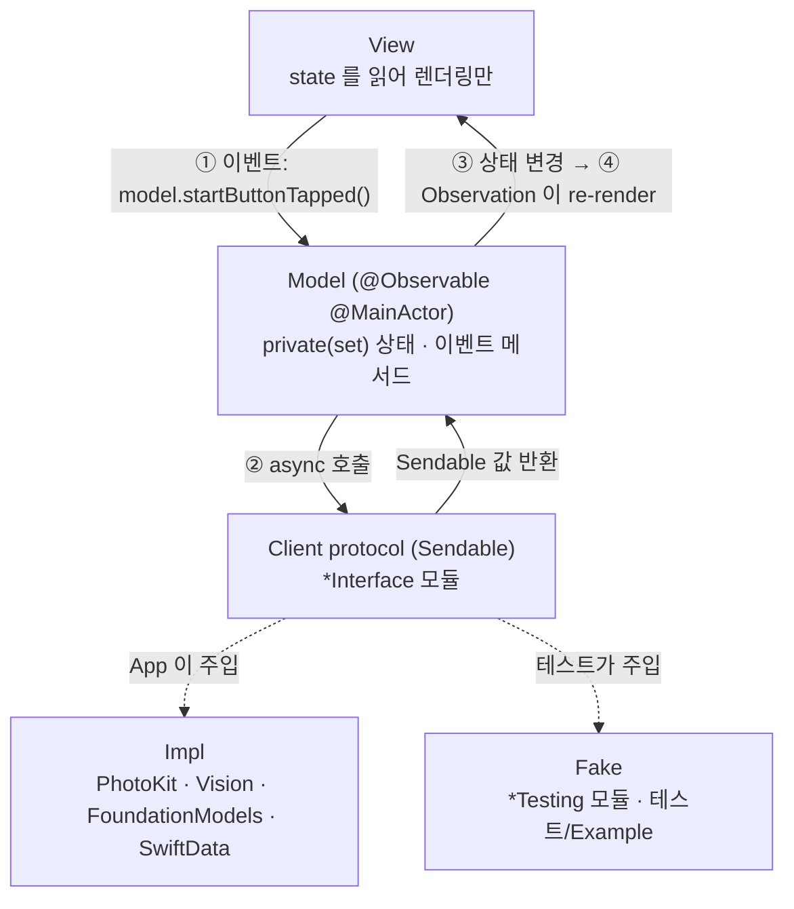
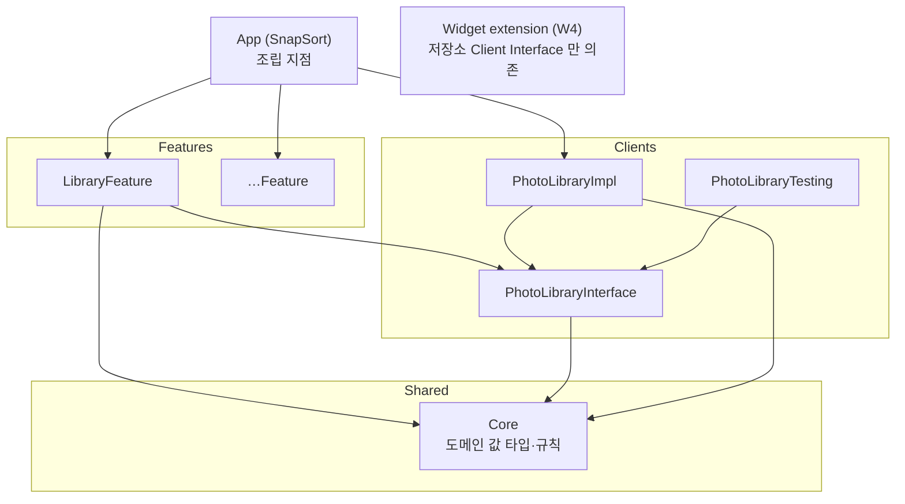

# 아키텍처

두 가지 결정 위에 서 있다.

1. **규칙 기반 단방향 MV.** SwiftUI 의 `@Observable` 모델을 View 에 직접 연결한다(Apple 샘플과 같은 방식). 단방향 흐름은 프레임워크가 아니라 규칙과 lint 로 강제한다.
2. **모듈러 아키텍처.** 외부 시스템은 Client 모듈로 감싸고, 각 Client 를 Interface / Impl / Testing 으로 나눈다. Feature 는 Interface 에만 의존한다.

## 1. 실행 흐름



### 단방향 규칙
| # | 규칙 | lint 로 강제 |
|---|---|---|
| 1 | Model 의 상태 프로퍼티는 모두 `public private(set) var` | 리뷰 |
| 2 | View 는 Model 의 **이벤트 메서드**만 호출한다. 이름은 "무슨 일이 일어났는가"로 짓는다: `onAppear()`, `startButtonTapped()`, `queryChanged(_:)` | 리뷰 |
| 3 | 입력 컨트롤은 `Binding(get: { model.query }, set: { model.queryChanged($0) })` 으로 연결한다. `$model.query` 금지 | `no_two_way_model_binding` |
| 4 | 부수효과(권한, OCR, 저장, 알림)는 Model 메서드 안에서 Client 를 통해서만 실행한다. View 에서 `Task { PHPhotoLibrary… }` 금지 | `system_framework_only_in_impl` |
| 5 | Model 은 `@MainActor`, Client 가 주고받는 값은 `Sendable`. `PHAsset` 같은 비 Sendable 객체는 식별자나 Core 의 `Sendable` 값 타입(예: `ImageAsset`)으로 바꿔서 넘긴다 | 컴파일러 (Swift 6 strict) |
| 6 | Model 끼리 직접 참조하지 않는다. 화면 간 흐름은 App 이 조립하거나 공유 Client 를 거친다 | 모듈 경계 |
| 7 | Model 은 App(또는 Example 앱)이 `@State` 로 **소유**하고, View 는 `let model: XxxModel` 로 **참조**만 한다. View 안에서 Model 을 생성하거나 `@State` 로 다시 감싸지 않는다 | 리뷰 |
| 8 | View 전용 일시 상태(애니메이션, 포커스, 시트 표시 여부)는 View 의 `@State private var` 로 둬도 된다. 화면에만 걸린 시스템 UI 설정(예: 기록 중 자동 잠금 끄기 `isIdleTimerDisabled`)도 View 가 맡는다. 저장·외부로 남지 않고 화면을 떠나면 되돌리므로 규칙 4 의 부수효과가 아니다. 비즈니스 의미가 있으면 Model 로 옮긴다 | 리뷰 |

### 예시 (OnboardingFeature)
```swift
@MainActor
@Observable
public final class OnboardingModel {
  public private(set) var access: PhotoAccessState

  @ObservationIgnored private let photoLibrary: any PhotoLibraryClient

  public func startButtonTapped() async {
    self.access = await self.photoLibrary.requestAccess()
  }
}

// View
Button("정리 시작하기") { Task { await self.model.startButtonTapped() } }

// App: 화면 간 흐름은 App 이 정한다 (규칙 6)
if self.onboardingModel.access.canRead {
  LibraryView(model: self.libraryModel)
} else {
  OnboardingView(model: self.onboardingModel)
}
```

## 2. 모듈 구조



### 모듈 종류와 타깃
| 종류 | 위치 | 타깃 | 역할 |
|---|---|---|---|
| App | `Projects/App` | `SnapSort` | 유일한 조립 지점. Impl 을 생성해 Model 에 주입 |
| Feature | `Projects/Features/<Name>` | `<Name>Feature` · `<Name>FeatureTests` · `<Name>FeatureExample` | 화면 하나 또는 흐름 하나. Model + View |
| Client | `Projects/Clients/<Name>` | `<Name>Interface` · `<Name>Impl` · `<Name>Testing` · `<Name>Tests` | 외부 시스템 경계 |
| Shared | `Projects/Shared/<Name>` | `<Name>` · `<Name>Tests` | 여러 모듈이 함께 쓰는 코드. `Core`(도메인 값 타입·규칙), `DesignSystem`(W4, 공용 UI) |

- **Interface**: 프로토콜과 값 타입(`PhotoAccessState` 등)만. Apple 데이터 프레임워크와 CoreLocation·MapKit 을 import 하지 않는다.
- **Impl**: 프로토콜 구현. 구현 타입 이름은 `<Name>ClientImpl`. Apple 데이터 프레임워크(Photos·Vision·FoundationModels·SwiftData·StoreKit·UserNotifications) import 는 여기서만. 예외: Feature View 의 MapKit `Map` 렌더링(§4). 이 목록과 CoreLocation·MapKit(§4 경계) 밖의 iOS 프레임워크(CoreGraphics·ImageIO 등)는 Core 를 포함한 모든 레이어에서 쓸 수 있다. 제한은 권한·저장·외부 서비스 같은 부수효과를 Impl 에 가두기 위한 것이므로, 부수효과 없는 프레임워크를 피하려고 실행 비용을 들이지 않는다.
- **Testing**: `<Name>ClientFake`. 고정 값을 돌려주는 `struct` 로 시작하고, 호출 기록이 필요하거나 호출 사이에 상태가 남아야 하면(저장 결과, 바뀐 권한) 그때 상태를 `Mutex` 로 보호하는 `final class` 로 확장한다.
- **Example**: Fake 로 Feature 를 단독 실행하는 데모 앱. **`#Preview` 도 여기에 둔다** (Feature 모듈이 Testing 에 의존하지 않도록).
- **Debug 전용 Feature**(SampleRecorder): Sources 의 모든 파일을 `#if DEBUG` 로 감싸고 App 도 `#if DEBUG` 에서만 연결해 Release 에 들어가지 않는다(Tuist 의존성은 구성별로 나눌 수 없어 Release 에서는 빈 모듈을 링크한다). 확인은 `SnapSort` 스킴을 Release 구성으로 빌드한 뒤 `nm` 으로 한다(수동, PR 본문). Example 앱은 Debug 로만 빌드하므로 모든 타깃을 담은 `SnapSort-Workspace` 스킴은 Release 로 빌드되지 않는다.
- **Shared**: Apple 데이터 프레임워크, CoreLocation·MapKit, Client 모듈을 import 하지 않는다. Core 는 부수효과 없는 순수 코드이고(SwiftUI·UIKit 도 쓰지 않는다. lint `core_no_ui_framework`), 좌표·분석 이미지처럼 여러 Client 의 Interface 가 함께 쓰는 값 타입을 둔다. DesignSystem 은 SwiftUI 까지 쓴다.

### 의존 규칙
| from ↓ / to → | Feature | Interface | Impl | Testing | Shared |
|---|---|---|---|---|---|
| App | ✅ | ✅ | ✅ | ❌ | ✅ |
| Feature | ❌ | ✅ | ❌ | ❌ | ✅ |
| Feature Tests / Example | 자기 Feature | ✅ | ❌ | ✅ | ✅ |
| Client Interface | ❌ | ❌ | ❌ | ❌ | ✅ |
| Client Impl | ❌ | 자기 Interface (+ 다른 Interface) | ❌ | ❌ | ✅ |
| Client Tests | ❌ | ✅ | 자기 Impl | 자기 Testing (+ Impl 이 쓰는 다른 Client 의 Testing) | ✅ |
| Shared | ❌ | ❌ | ❌ | ❌ | ❌ (필요해지면 템플릿에 인자를 추가하고 연다) |

### 빌드 설정
- 모든 모듈은 static framework. iPhone 전용, iOS 26.0+, Swift 6 언어 모드, `SWIFT_STRICT_CONCURRENCY=complete`.
- 설정은 `Tuist/ProjectDescriptionHelpers/Project+Templates.swift` 의 `Env` 에서만 바꾼다. 개별 매니페스트에서 덮어쓰지 않는다.
- 서명: 모든 타깃이 Xcode 자동 서명(`CODE_SIGN_STYLE=Automatic`)과 `Env.developmentTeam` 팀을 쓴다. 실기기 빌드는 Xcode 가 인증서·프로파일을 관리하고, `make build`/`make test` 와 CI 는 `CODE_SIGNING_ALLOWED=NO` 로 서명 없이 빌드한다.
- 타깃 소스·리소스는 Xcode 동기화 폴더(`buildableFolders`)로 연결한다. 기존 폴더 안에서 파일을 추가·삭제하면 다시 생성하지 않아도 Xcode 와 빌드에 반영된다. 모듈·타깃·의존성을 바꿀 때만 `make project` 를 다시 돌린다.

## 3. 모듈 추가 방법

### Client 추가 (예: ImageAnalysis)
1. `Tuist/ProjectDescriptionHelpers/Module.swift` 의 `Client` 에 `case imageAnalysis = "ImageAnalysis"` 추가.
2. 디렉터리 생성: `Projects/Clients/ImageAnalysis/{Interface,Impl,Testing,Tests}` + `Project.swift`:
   ```swift
   import ProjectDescription
   import ProjectDescriptionHelpers

   let project = Project.client(.imageAnalysis, shared: [.core])
   ```
   Impl 이 다른 Client 를 조합하면(예: Indexing) `clients: [.photoLibrary, …]` 를 더한다. Impl 에는 그 Interface 가, Tests 에는 Interface 와 Testing(Fake)이 연결된다.
3. Interface 에 `public protocol ImageAnalysisClient: Sendable` 과 입출력 값 타입, Impl 에 `ImageAnalysisClientImpl`, Testing 에 `ImageAnalysisClientFake`, Tests 에 Impl 의 순수 로직 테스트.
4. 사용하는 Feature 매니페스트의 `clients:` 에 추가하고, App 매니페스트에 `.client(impl: .imageAnalysis)` 추가.
5. `make project && make test`.

### Shared 추가 (예: Core)
1. `Module.swift` 의 `Shared` 에 `case core = "Core"` 추가.
2. `Projects/Shared/Core/{Sources,Tests}` + `Project.swift`:
   ```swift
   let project = Project.shared(.core)
   ```
3. 쓰는 모듈의 매니페스트에 연결한다: Feature 는 `Project.feature(_, clients:, shared: [.core])`, Client 는 `Project.client(_, shared: [.core])`, App 은 `dependencies` 에 `.shared(.core)`.
   DesignSystem 같은 공용 UI 모듈은 Feature 와 App 에서만 쓴다 (Interface 는 프로토콜과 값 타입만).

### Feature 추가 (예: Onboarding)
1. `Feature` 에 `case onboarding = "Onboarding"` 추가.
2. `Projects/Features/Onboarding/{Sources,Tests,Example}` + `Project.swift`:
   ```swift
   let project = Project.feature(.onboarding, clients: [.photoLibrary])
   ```
3. `Sources` 에 `OnboardingModel`, `OnboardingView`. `Tests` 에 Model 테스트. `Example` 에 `@main` 데모 앱과 `#Preview`.
4. App 매니페스트 dependencies 에 `.feature(.onboarding)` 추가, `SnapSortApp` 에서 Model 을 만들어 연결.

## 4. 확정된 기술 결정
| 결정 | 이유 |
|---|---|
| 서버 없음 | "사진이 밖으로 나가지 않는다"가 제품 가치. StoreKit 2 는 기기에서 영수증 검증 |
| 위치·지도는 Apple 시스템 서비스 | 장소 이름 변환은 MapKit `MKReverseGeocodingRequest`(`CLGeocoder` 는 iOS 26 에서 deprecated. 요청 수 제한이 있으므로 사진마다가 아니라 위치 묶음마다), 지도 핀은 MapKit `Map`. 모듈 경계: ① Feature View 는 `Map` 렌더링만을 위해 MapKit 을 import 할 수 있다 ② 지오코딩과 지도 앱 열기는 부수효과이므로 Client Impl 에서 한다 ③ Interface 의 좌표는 자체 `Sendable` 값 타입으로 둔다(`CLLocationCoordinate2D` 노출 금지). Shared·Interface·Testing 의 CoreLocation·MapKit import 는 lint(`location_map_only_outside_shared_interface`)가 막고, Feature 의 `Map` 렌더링 외 사용은 리뷰로 잡는다. 이때 **위치 좌표만** Apple 로 가고 사진과 OCR 텍스트는 보내지 않는다. OCR 로 읽은 주소를 지도 앱으로 넘기는 것은 사용자가 누를 때만. 개인정보 처리방침에 명시한다. 지오코딩 요청 원칙: ① 사용자가 장소가 필요한 화면(여행 폴더)을 열 때만 요청하고 결과는 기기에 캐시한다. 여행은 판정할 때마다 다시 만들어지므로 캐시 키는 여행이 아니라 ③의 반올림한 중심점이다. 백그라운드 일괄 지오코딩 금지 ② 사진 좌표는 여행 판정이 찾은 여행(Core `Trip`)의 중심점만 지오코딩하고, 여행이 아닌 사진 좌표 묶음은 지오코딩하지 않는다. 여행은 자주 가는 지역 밖에서만 나오므로 집 근처 좌표는 보내지 않는다 ③ 보내는 좌표는 묶음 중심점을 소수점 2자리(약 1km)로 반올림한 값. 구체적인 수치는 구현 PR 에서 조정할 수 있다 |
| 분류 대상 | 보관함의 모든 이미지(영상 제외). 스크린샷 여부(`.photoScreenshot`)는 조회 필터가 아니라 분류 신호로 쓴다 |
| 분류 3단 파이프라인 | ① 메타데이터(스크린샷 여부·위치·날짜·크기, 픽셀을 읽지 않음) → ② Vision 이미지 분류(`ClassifyImageRequest`) 라벨(ImageAnalysis Client, Core `ImageLabel`. 신뢰도 기준(Core `ClassificationRules.minimumLabelConfidence`, 임시 0.1)은 정확도 측정 작업에서 확정. 시뮬레이터에서는 동작하지 않아 실기기로 확인한다) → ③ 스크린샷, 정보형·글자가 많은 라벨(`document`·`receipt`·`coupon`·`ticket` 등)이 있는 이미지, 위치도 사진형 라벨도 없는 이미지(앨범에 저장한 기프티콘·쿠폰 등. 촬영 정보(EXIF)는 이미지 데이터를 읽어야 해서 이 대체 신호를 쓴다)만 OCR(대상 판정은 Core `TextRecognitionPolicy`. `RecognizeTextRequest`. ImageAnalysis Client, Core `RecognizedTextLine` = 줄 텍스트·신뢰도·왼쪽 위 원점 정규화 위치. 한국어 우선 + 영어, 정확도 우선 + 언어 보정. 빈 줄만 버리고 신뢰도 기준은 정확도 측정 작업에서 정한다)·바코드 인식(`DetectBarcodesRequest`) + 키워드 규칙(Core `RuleClassifier` 순수 함수: 정보형은 라벨 하나 또는 OCR 키워드 기준 개수 이상, 대화 캡처는 말풍선 시각 줄로도, 사진형은 스크린샷(메타데이터 또는 `screenshot` 라벨)이 아닐 때 라벨로 정한다. 여행은 여행 판정이 정한다). 라벨·키워드 표(Core `ClassificationRules`)와 OCR 대상 조건은 정확도 측정 작업에서 픽스처(저장한 기프티콘 포함. Core 테스트의 `ClassificationSamples.json` 에 실기기에서 기록한(기록 도구, 이 표의 "기록 도구 (Debug 전용)" 행. 라벨은 0.01 까지 기록) 분류 입력과 기대 카테고리를 둔다, CONVENTIONS §3. 시드 샘플: `ClassificationAccuracyTests` 머리 주석)로 조정한다. ①~③은 모든 기기에서 동작하고, Foundation Models 는 ③의 텍스트 해석(기프티콘 브랜드·만료일 등)에만 `SystemLanguageModel.default.availability == .available` 인 기기에서 쓴다. Vision 은 Swift 네이티브 API(`VN` 접두사 없는 async 요청)만 쓴다 |
| 분석 이미지 크기 | 이미지 분류·유사 이미지는 썸네일(`ImageSize.thumbnail`)로, OCR·바코드는 기기에 있는 가장 큰 버전(`.largestAvailable`)으로 분석한다. PhotoLibrary 가 Core 의 `AnalysisImage`(디코딩된 `CGImage` + 방향 + 대체 버전 여부 `isLocalFallback`)로 읽어 주고, 분석 Client 는 이것만 받는다(Photos import 는 PhotoLibrary Impl 한 곳). 어느 경우든 `isNetworkAccessAllowed = false` 로 iCloud 원본을 내려받지 않는다. 원본이 iCloud 에만 있으면 기기에서 바로 줄 수 있는 버전을 쓰고(가장 큰 버전이라는 보장은 없다) 대체 버전이면 `isLocalFallback` 으로 표시하며(기록 도구가 센다), 그것도 없으면 `ImageLoadError.notAvailableLocally` 로 알려 받는 쪽이 나중에 다시 시도한다. 크기 기준(썸네일 긴 변 임시 512px, `.largestAvailable` 픽셀 수 상한 임시 약 12.6MP(4096×3072))은 정확도·1만 장 측정 작업에서 확정한다. 원본은 디코딩하면서 상한으로 줄여(`CGImageSourceCreateThumbnailAtIndex`) 48MP 한 장에 약 190MB 대신 약 50MB 만 쓴다. 상한을 긴 변이 아니라 픽셀 수로 두어 스크롤 캡처·긴 영수증처럼 세로로 긴 이미지도 폭이 지나치게 줄지 않는다 |
| 카테고리 | 정보형(기프티콘·영수증·대화 캡처·쇼핑·지도·문서/메모), 사진형(여행·음식·인물·반려동물·풍경), 기타. 한 이미지가 여러 카테고리에 속할 수 있다 |
| 여행 판정 | 이미지 라벨이 아니라 위치·날짜로 판단한다(Core `TravelDetector` 순수 함수, 결과는 Core `Trip` = 사진 식별자·기간·중심점. 중심점은 사진이 가장 많은 칸 안의 사진 평균이라 자주 가는 지역이나 여행지 사이에 떨어지지 않는다). 여행은 "평소와 다른 곳"이라서 먼저 자주 가는 지역을 정한다: 지역 칸(위도·경도 0.18도. 위도 방향 약 20km, 서울에서 경도 방향 약 16km)마다 방문(그 칸과 맞닿은 칸에서 빈 날 하루까지 이어 사진을 찍은 기간 중 그 칸에 들른 날들. 맞닿은 칸을 오가도 한 번)을 묶고, 사진이 속한 방문의 앞뒤 3개월 안에 방문이 3번 이상이거나 첫날과 마지막 날이 60일 이상 떨어진 방문이 있는 곳, 보관함 전체에서 찍은 날이 가장 많은 곳(보관함이 짧거나 집 사진이 드물 때를 위해), 그리고 그 칸에 맞닿은 칸. 사진 수나 날 수로 세면 여행에서 많이 찍거나 오래 머문 곳이, 달로 세면 달 경계에 걸친 여행 하나가 두 번으로 세어지므로 방문으로 센다. 보관함 전체가 아니라 그 방문 무렵을 보므로 몇 년 또는 몇 달에 걸쳐 같은 곳에 간 여행도 각각 여행이고(3개월 간격 이하로 세 번 이상 가면 가운데 방문은 자주 가는 곳으로 본다), 달 경계에 걸친 체류도 60일 미만이면 여행이다. 60일 이상 머문 곳은 생활한 곳으로 본다. 방문 단위로 판정하므로 여행이 중간에 잘리지 않는다. 이사한 곳·본가처럼 자주 가는 곳이 여럿이어도 규칙 하나로 처리한다. 자주 가는 지역 밖에서 찍은 사진을 빈 날 하루까지 이어 묶고, 중간에 자주 가는 지역에서 찍은 사진이 있으면(같은 날이어도) 끊는다. 5장 미만인 묶음은 버린다(당일치기는 포함). 위치나 날짜가 없는 이미지는 쓰지 않는다. 자주 가는 지역은 판정 안에서만 쓰고 저장하거나 보여 주지 않는다. 수치는 임시이며 정확도 측정 작업에서 조정한다. 제한 접근(`.limited`)이면 사용자가 고른 사진만으로 판정하고, 정확도가 낮을 수 있다고 화면에 안내한다 |
| 저장소 | SwiftData, PhotoStore Client. 이미지마다 메타데이터·Vision 라벨·OCR 줄(OCR 하지 않았으면 없음)·카테고리를 저장한다. 라벨·OCR 줄을 함께 두는 것은 분류 규칙을 바꿔도 Vision 을 다시 돌리지 않고 카테고리를 다시 정하고, 캡처 정보 추출·검색이 OCR 을 다시 하지 않게 하기 위해서다. 여행(Core `Trip`)은 판정할 때마다 통째로 바꾸고, 여행 폴더에 그 기간의 다른 카테고리 이미지를 모으는 것은 관계로 저장하지 않고 조회할 때 기간으로 찾는다. 기프티콘 만료일·사용 여부, 영수증 가게·금액 같은 추출 값은 그 값을 만드는 추출 작업에서 필드를 더한다(출시 전이라 데이터를 옮기지 않는다). iCloud(CloudKit) 동기화는 앱 권한과 관계없이 끈다(`cloudKitDatabase: .none`). 저장 결과는 보관함에서 다시 만들 수 있으므로 OCR 텍스트가 기기 백업(iCloud·컴퓨터)으로 나가지 않게 저장 파일 폴더를 백업에서 뺀다(`isExcludedFromBackup`. SQLite 의 -wal·-shm 파일도 빠지도록 폴더에 표시하므로 폴더는 저장소 전용). 기기를 바꾸면 처음부터 다시 인덱싱한다. 개인정보 처리방침에 명시한다. 저장 파일 위치는 App 이 `PhotoStoreClientImpl(url:)` 로 넘기고(W2 는 Application Support 의 `PhotoStore/` 폴더), 위젯과 나눠 쓰는 App Group 컨테이너로는 위젯 작업(W4)에서 App 의 이 위치를 바꾼다. 위젯은 별도 프로세스라 같은 위치로 저장소를 열어야 하므로, 위젯이 저장소를 어떻게 얻는지(Interface 만 의존하는 규칙과 함께)는 W4 위젯 작업에서 정한다 |
| 인덱싱 | Indexing Client 가 PhotoLibrary·ImageAnalysis·PhotoStore Interface 를 조합한다(Impl 에 Apple 프레임워크 없음). `run()` 이 진행률(`IndexingProgress` = 전체·저장·미룬 수) 스트림을 돌려주고, 구독을 끝내면(Task 취소) 멈춘다. 보관함 변경을 먼저 구독한 뒤 보관함 전체를 저장소 식별자와 비교해, 지워진 이미지의 결과를 지우고 새 이미지만 최신순으로 분석한다. 비교 기준은 지금 읽을 수 있는 이미지라서 제한 접근(`.limited`)이면 고르지 않은 이미지의 결과도 지운다(고른 사진만 분류한다는 화면 안내와 같다. 다시 전체 접근을 주면 처음부터 분석한다). 이후 증분 변경은 식별자 집합으로 반영해 같은 변경이 두 번 와도 결과가 같고, `.reloadAll` 이면 전체를 다시 비교한다. 한 장씩 차례로 분석하고(동시 처리 수는 1만 장 측정 작업에서 정한다) 50장(임시)마다 저장·삭제한다. 저장소의 식별자 목록 조건 크기를 이 수로 묶고, 중간에 멈춰도 이 수만큼만 다시 분석한다. 이미지를 읽지 못하거나(iCloud 에만 있음 `notAvailableLocally`·손상) 분석에 실패하면 저장하지 않고 미룬 수로 세어 다음 실행이나 `.reloadAll` 때 다시 시도한다. OCR 대상인데 OCR 하지 못한 이미지도 저장하지 않는다(저장하면 OCR 대상이 아니었던 이미지와 구분되지 않는다). 보관함에 없는 이미지(`notFound`)는 전체 수에서 빼고 여행을 다시 판정한다. 저장소를 읽거나 쓰지 못하면 멈추고 스트림을 끝낸다. 사진을 읽을 권한이 없으면 조회 결과가 비어 저장 결과가 모두 지워지므로, 비교하지 않고 저장 결과를 그대로 둔 채 끝낸다. 여행 판정은 메타데이터만 보므로 분석을 기다리지 않고 보관함이 바뀔 때마다 전체를 다시 판정해 바꾼다. 이미 반영한 변경이 다시 와서 보관함이 그대로면 다시 판정·저장하지 않는다(판정 비용은 1만 장 측정 작업에서 확인한다). 한계: 보관함 변경 알림은 추가·삭제만 보내므로, 사진의 위치·날짜를 고치거나 iCloud 에만 있어 미룬 이미지가 기기로 내려와도 다음 `.reloadAll` 이나 다음 실행 전까지 반영하지 않는다. 내용 변경을 반영할지(`ImageChange` 에 변경 추가)는 별도 작업에서 정한다. 보관함 화면이 떠 있는 동안(`LibraryModel.onAppear()` 가 구독하는 동안, 진행률은 Model 상태 `indexingProgress`) 메인 밖 낮은 우선순위(`.utility`) Task 로 돌린다. 화면은 분석 중일 때만 진행률을 보여 주고 다 분석하면(`isFinished`) 숨긴다. `isFinished` 는 미룬 수까지 더해 판단하므로, 미룬 이미지가 있으면 다 분석한 뒤에도 그 수를 남겨 다음에 다시 시도한다고 안내한다. 첫 진행률은 보관함과 저장소 비교를 마친 뒤에 오므로, 그 전에도 분석 중(`isIndexing`)으로 안내한다. 정상이면 스트림이 끝나지 않으므로, 끝나면 첫 진행률을 받기 전이라도 멈춘 것(`isIndexingStopped`)으로 보고 다시 시도 버튼을 보여 준다(진행률을 받았으면 마지막 값도 함께. 다 분석한 뒤 보관함 변경을 반영하다 멈췄으면 개수 대신 새 사진을 분류하지 못했다고 안내한다)(다시 시도는 `run()` 을 다시 불러 저장된 데까지 건너뛴다. 원인별 안내는 `run()` 이 원인을 알려야 해서 별도 작업). 보관함 화면은 같은 저장소(PhotoStore Interface)를 직접 읽어 카테고리별 개수와 여행 수를 보여 주고, 저장·삭제·여행 교체마다 오는 진행률을 받을 때마다, 그리고 멈출 때 다시 읽는다. 저장소를 열지 못하면 App 이 인덱서와 저장소 없이(nil) 주입하고 보관함만 보여 준다. 앱이 닫혀 있을 때의 처리(`BGProcessingTask`)는 별도 작업에서 정한다 |
| 기록 도구 (Debug 전용) | 실기기에서 정확도 샘플을 기록하고 분류 단계별 시간을 재는 개발 도구(`SampleRecorderFeature`, Release 에 넣지 않는다 §2). 보관함 화면 아래의 "기록" 버튼으로 들어가고, App 이 루트를 기록 화면으로 바꿔 보관함 화면의 구독이 끝나므로 측정하는 동안 인덱서가 멈춘다(돌아가면 저장된 데까지 건너뛰고 다시 시작한다). 이미지 선택: 정확도 모드는 앨범 "SnapSort 샘플" 의 이미지를 앨범 순서로(사용자 앨범을 읽어야 해서 전체 접근에서만), 속도 모드는 보관함 최신 100·1,000·10,000장 중에서 고른다. 측정은 인덱서의 `IndexingRun.analyze` 와 같은 순서(썸네일 로드 → 분류 → OCR 대상이면 원본 로드 → OCR)로 한 장씩, 인덱서와 같은 `.utility` 우선순위로 메인 밖에서 하고, 라벨은 기준 조정을 위해 0.01 이상까지 받는다(OCR 대상 판정과 분류는 운영 기준으로 거른 라벨로). 정확도 모드는 판정 규칙을 바꿔도 다시 기록하지 않도록 OCR 대상이 아니어도 OCR 한다. 그래서 원본 로드나 OCR 에 실패한 이미지는 OCR 대상이 아니어도 샘플에서 건너뛴다(OCR 줄 없이 기록하면 OCR 대상 조건을 바꾸는 실험에서 그 샘플이 틀린 입력이 된다). 건너뛴 이미지는 화면에 이유별 개수로 보이고(진행 중에는 총수), 측정 파일에는 처리 순서(정확도 모드는 앨범 순서)·이유·단계로 남는다. 출력은 두 JSON 이고 일부 대상을 뺀 공유 시트로 옮긴다(뺄 대상과 규칙은 CONVENTIONS §4): 샘플 초안(`ClassificationSamples-draft-*.json`. 픽스처와 같은 키에 기대 카테고리 대신 규칙 분류 결과 `predicted`)과 측정 파일(`IndexingTiming-*.json`. 단계별 시간·요약, 발열 상태 변화·저전력 모드, 속도 모드는 보관함 전체 여행 판정 시간. 식별자·라벨·OCR 텍스트·촬영 날짜는 넣지 않는다). 측정 한계: 저장소 저장·삭제 시간은 재지 않고, 인덱서가 이미 읽은 썸네일은 사진 캐시로 더 빠를 수 있으며, 첫 이미지에는 Vision 모델 로딩이 들어간다(따로 보고한다). 결과 파일의 개인정보 규칙은 CONVENTIONS §4 |
| 만료 알림 | `UNCalendarNotificationTrigger` 로컬 알림 — 서버 푸시 없음 |
| TCA 등 외부 아키텍처 라이브러리 | 사용하지 않음. 외부 의존성 0 을 유지하고, 추가하려면 사전 합의 |
